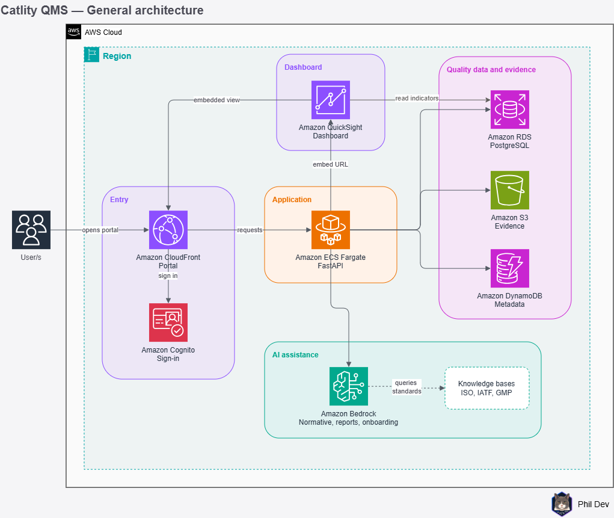
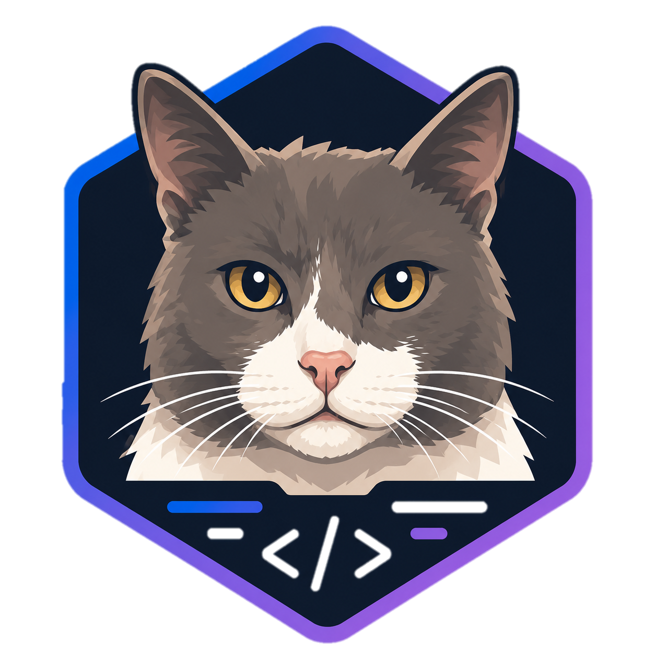

# Catlity QMS

Multi-tenant SaaS platform for quality management and auditing, powered by specialized AI agents that understand industry-specific regulatory standards.

The MVP targets the automotive industry (IATF 16949) with built-in extensibility for additional industries (pharmaceutical, food, etc.).

A Phil Dev project.

## Architecture



The platform is composed of:

- **Frontend**: React SPA with Ant Design, authentication via AWS Amplify/Cognito
- **Backend**: REST API built with FastAPI, deployed on ECS/Fargate
- **Database**: Amazon RDS PostgreSQL with multi-tenancy via `tenant_id`
- **Storage**: S3 for documentary evidence, DynamoDB for metadata
- **AI Agents**: 3 specialized agents on Amazon Bedrock with Knowledge Bases
  - Normative Agent (ISO/IATF/GMP regulatory queries)
  - Report Agent (audit report draft generation)
  - Onboarding Agent (new tenant configuration)
- **Dashboard**: Amazon QuickSight embedded with row-level security
- **IaC**: Terraform with mandatory tagging (`Project: catlity-qms`)

## Tech Stack

| Layer | Technology |
|-------|------------|
| Frontend | React + TypeScript + AWS Amplify + Ant Design |
| Backend API | FastAPI (Python) on ECS/Fargate |
| Database | Amazon RDS PostgreSQL |
| Documents/Evidence | Amazon S3 |
| Metadata | Amazon DynamoDB |
| Authentication | Amazon Cognito |
| AI Agents | Amazon Bedrock + Knowledge Bases |
| Dashboard | Amazon QuickSight |
| IaC | Terraform |
| CI/CD | GitHub Actions |
| Cost Monitoring | AWS Cost Explorer + AWS Budgets |

## Repository Structure

```
catlity-qms/
├── frontend/                 # React + TypeScript + Ant Design
├── backend/                  # FastAPI (Python)
├── infra/                    # Terraform modules
├── docs/
│   ├── PLAN.md              # Full implementation plan
│   └── diagrams/            # Architecture diagrams (PNG)
├── knowledge-base/
│   ├── common/              # ISO 9001
│   ├── automotive/          # IATF 16949
│   └── pharmaceutical/      # GMP
├── .github/workflows/       # CI/CD pipelines
├── .gitignore
└── README.md
```

## Local Development Setup

### Prerequisites

- Python 3.12+
- Node.js 20+
- Docker and Docker Compose
- Terraform 1.6+
- AWS CLI configured with a valid profile

### Backend

```bash
cd backend
python -m venv .venv
source .venv/bin/activate  # Windows: .venv\Scripts\activate
pip install -r requirements.txt
docker-compose up -d  # Local PostgreSQL
alembic upgrade head
uvicorn app.main:app --reload
```

### Frontend

```bash
cd frontend
npm install
npm run dev
```

### Infrastructure

```bash
cd infra/environments/dev
terraform init
terraform plan
terraform apply
```

## Cost Monitoring

All AWS resources are tagged with `Project: catlity-qms` for filtering in Cost Explorer. AWS Budgets alerts are configured at 50%, 80%, and 100% of the monthly budget.

## License

Proprietary — Phil Dev <sub></sub>
