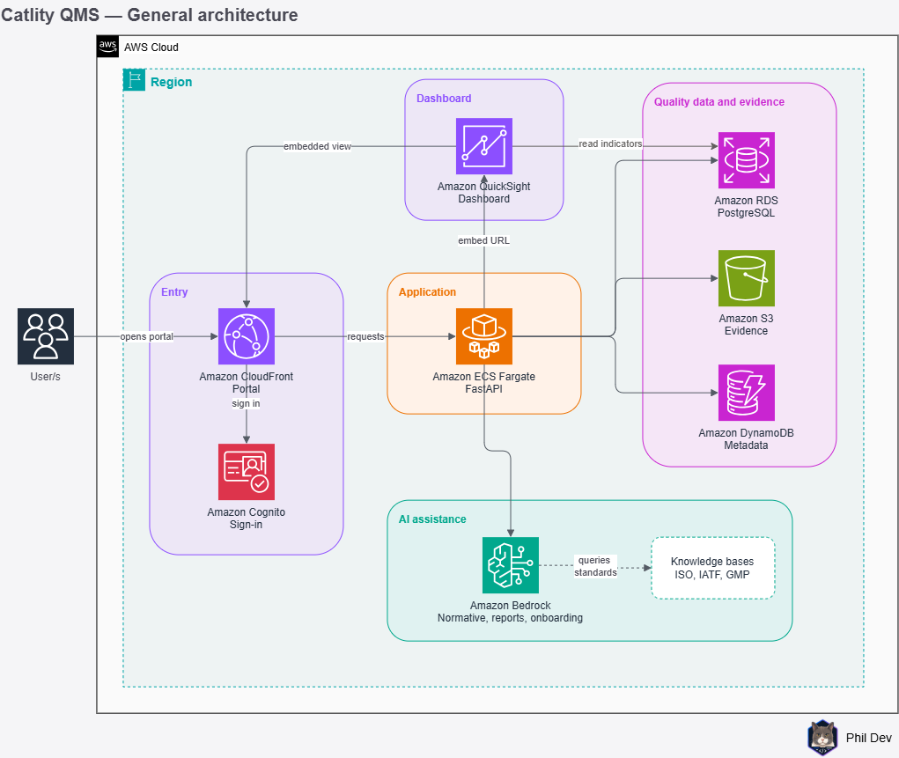
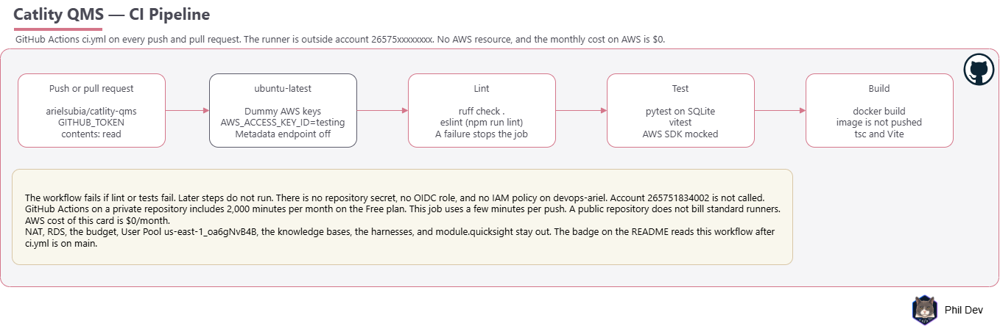
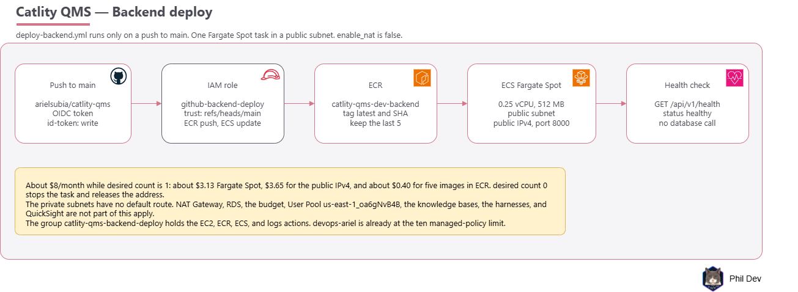
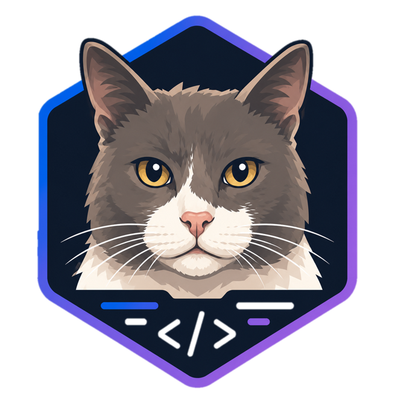

# Catlity QMS

[](https://github.com/arielsubia/catlity-qms/actions/workflows/ci.yml)

Multi-tenant SaaS platform for quality management and auditing, powered by specialized AI agents that understand industry-specific regulatory standards.

The MVP targets the quality industry (ISO 9001) with built-in extensibility for additional industries (aeronautica, food, etc.).


## Architecture



The platform is composed of:

- **Frontend**: React SPA with Ant Design, authentication via AWS Amplify/Cognito
- **Backend**: REST API built with FastAPI, targeted for ECS/Fargate
- **Database**: Amazon RDS PostgreSQL with multi-tenancy via `tenant_id`
- **Storage**: S3 for documentary evidence (Intelligent-Tiering), DynamoDB for evidence metadata
- **AI Agents**: 3 specialized agents on Amazon Bedrock with Knowledge Bases
  - Normative Agent (ISO/IATF/GMP regulatory queries)
  - Report Agent (audit report draft generation)
  - Onboarding Agent (new tenant configuration)
- **Dashboard**: Amazon QuickSight embedded with row-level security
- **IaC**: Terraform with mandatory tagging (`Project: catlity-qms`)

## Tech Stack

| Layer | Technology |
|-------|------------|
| Frontend | React + TypeScript + AWS Amplify + Ant Design |
| Backend API | FastAPI (Python); ECS/Fargate is the target runtime |
| Database | Amazon RDS PostgreSQL |
| Documents/Evidence | Amazon S3 |
| Metadata | Amazon DynamoDB |
| Authentication | Amazon Cognito |
| AI Agents | Amazon Bedrock + Knowledge Bases |
| Dashboard | Amazon QuickSight |
| IaC | Terraform |
| CI/CD | GitHub Actions (`ci.yml` on pull requests and pushes to `main`; `deploy-backend.yml` on pushes to `main`) |
| Cost Monitoring | AWS Cost Explorer. AWS Budgets is defined and not applied |

## Repository Structure

```
catlity-qms/
├── frontend/                 # React + TypeScript + Ant Design
├── backend/                  # FastAPI (Python)
│   ├── app/
│   │   ├── main.py          # FastAPI application entry point
│   │   ├── core/            # Config, database, security
│   │   ├── models/          # SQLAlchemy ORM models
│   │   ├── schemas/         # Pydantic request/response schemas
│   │   ├── api/v1/          # API route handlers
│   │   └── services/        # Business logic layer
│   ├── alembic/             # Database migrations
│   ├── tests/               # pytest test suite
│   ├── Dockerfile
│   ├── docker-compose.yml   # Local dev (PostgreSQL + API)
│   ├── requirements.txt
│   └── requirements-dev.txt
├── infra/                    # Terraform modules
├── docs/
│   ├── PLAN.md              # Full implementation plan
│   └── diagrams/            # Architecture diagrams (PNG)
├── knowledge-base/
│   ├── common/              # ISO 9001
│   ├── automotive/          # IATF 16949
│   └── pharmaceutical/      # GMP
├── .github/workflows/       # ci.yml and deploy-backend.yml
├── .gitignore
└── README.md
```

## Continuous integration



GitHub Actions workflow `ci.yml` runs on every pull request and on every push to `main`, including the merge. A push to a feature branch that already has a pull request runs once, through the pull request event. One job on a GitHub-hosted `ubuntu-latest` runner lints with ruff and eslint, tests with pytest and vitest, and builds the backend Docker image and the Vite bundle. A failure in lint or tests stops the job, so the workflow fails. The image is not pushed to a registry.

Tests that import the AWS SDK receive dummy credentials (`AWS_ACCESS_KEY_ID=testing`, `AWS_SECRET_ACCESS_KEY=testing`, `AWS_DEFAULT_REGION=us-east-1`) and `AWS_EC2_METADATA_DISABLED=true`, so boto3 does not call AWS. The workflow token is limited to `contents: read`. That workflow has no repository secret and no OIDC role, and it does not call account `265751834002`. The backend deploy workflow below is the one that assumes a role in the account.

This adds no AWS resource. Monthly cost on AWS is **$0**. A private repository includes 2,000 GitHub Actions minutes per month on the Free plan, and this job uses a few minutes per push. A public repository does not bill standard runners. On Azure the same check is a pipeline with read access to the repo. On Google Cloud it is Cloud Build with read access to the source. Neither is used here.

The same commands run locally: `ruff check .` and `pytest tests/ -v` from `backend/`, and `npm run lint`, `npm test`, and `npm run build` from `frontend/`. `docker build -t catlity-qms-api:ci .` from `backend/` builds the image and does not push it. After `ci.yml` is on `main`, the badge at the top of this file shows the latest run. The diagram source is `docs/diagrams/ci-pipeline-flow.drawio`.

## Backend deploy



`deploy-backend.yml` runs only on a push to `main`. It assumes `catlity-qms-dev-github-backend-deploy` through GitHub's OIDC provider. This repository uses immutable subjects, so the role trusts only `repo:arielsubia@191406855/catlity-qms@1341227643:ref:refs/heads/main`. The workflow builds `backend/Dockerfile`, and pushes the image to the ECR repository `catlity-qms-dev-backend` with the commit SHA and with the tag `latest`. It then forces a new deployment of the ECS service `catlity-qms-dev-backend` and calls `GET /api/v1/health` on the task's public IPv4 address. The body has to contain `"status": "healthy"`. A pull request does not run this workflow. `ci.yml` still builds the image and does not push it.

The service keeps one Linux x86 task on the `FARGATE_SPOT` capacity provider: 0.25 vCPU and 512 MB, in the public subnets, with a public IPv4 address. Security group `catlity-qms-dev-ecs-sg` allows TCP 8000. A deployment stops the old task before it starts the new one, so two public addresses are not billed together. The circuit breaker rolls a failed deployment back. Container Insights is off. The execution role `catlity-qms-dev-backend-execution` can pull that repository and write to log group `/ecs/catlity-qms-dev-backend`, retained for 7 days. The task role `catlity-qms-dev-backend-task` is the name the evidence bucket already allows. It has no S3, DynamoDB, SES, or Bedrock permissions. `GET /api/v1/health` does not use PostgreSQL or AWS APIs.

`enable_nat` defaults to false. Applying `module.networking` with the backend creates the VPC, two public subnets, the internet gateway, two private subnets, and the security groups. It does not create the NAT Gateway or its Elastic IP, and the private route table has no route to the internet. RDS, the budget, User Pool `us-east-1_oa6gNvB4B`, `module.knowledge_base`, the existing harnesses, and `module.quicksight` stay out of this apply. `devops-ariel` is already at the ten-policy limit, so the EC2, ECR, ECS, and CloudWatch actions live on the group `catlity-qms-backend-deploy`. That group cannot create a NAT Gateway, allocate an Elastic IP, or call RDS.

While `backend_desired_count` is 1, the estimate in `us-east-1` is about $3.13 per month for this Fargate Spot size, $3.65 per month for the public IPv4, and about $0.40 per month if ECR keeps five images. The cluster, the roles, the OIDC provider, and an idle log group add no standing charge. Setting `backend_desired_count` to 0 stops the task and releases the address. ECR storage remains. On Azure the same shape is Container Registry plus a Container App. On Google Cloud it is Artifact Registry plus Cloud Run.

From `infra/`, with `TF_VAR_db_username` and `TF_VAR_db_password` set because those variables have no default:

```bash
terraform apply -var-file=environments/dev/terraform.tfvars \
  -target=module.backend.aws_iam_group.deploy \
  -target=module.backend.aws_iam_group_policy.deploy \
  -target=module.backend.aws_iam_group_membership.deploy

terraform apply -var-file=environments/dev/terraform.tfvars \
  -target=module.networking \
  -target=module.backend
```

The first apply only creates the group. The second creates the network and the service. The database module is not a target. Push an image to `catlity-qms-dev-backend:latest` before expecting the task to start, then force a new deployment. Check it with `curl http://<public-ip>:8000/api/v1/health`. The diagram source is `docs/diagrams/backend-deploy-flow.drawio`.

That apply is in place in `us-east-1`. The group came first (3 added). The network, repository, cluster, roles, and service followed (28 added, then the task definition and the service after `ecs:TagResource` was added for task definitions). Nothing was changed or destroyed. VPC `vpc-01e6caa1fbd35a158` has no NAT Gateway. `GET http://54.197.79.88:8000/api/v1/health` returned `"status": "healthy"`. The address changes when the task is replaced. Set `backend_desired_count` to 0 and apply `module.backend.aws_ecs_service.backend` to stop the task and release the public IPv4.

## Local Development Setup

### Prerequisites

- Python 3.12+
- Node.js 22.13+
- Docker and Docker Compose
- Terraform 1.6+
- AWS CLI configured with a valid profile

### Backend

```bash
cd backend
python -m venv .venv
source .venv/bin/activate  # Windows: .venv\Scripts\activate
pip install -r requirements-dev.txt

# Start local PostgreSQL
docker-compose up -d db

# Run migrations
alembic upgrade head

# Start API server (http://localhost:8000)
uvicorn app.main:app --reload

# Run tests
pytest tests/ -v

# Lint
ruff check .
```

Alternatively, run everything with Docker Compose:

```bash
cd backend
docker-compose up
```

The API will be available at `http://localhost:8000` with interactive docs at `/docs`.

#### Data Model

The backend uses a multi-tenant architecture with `tenant_id` on all tables:

- **Tenant** — Organization using the platform
- **User** — Team member linked to a tenant (roles: admin, lead_auditor, auditor, auditee, qa_manager)
- **Audit** — Audit session with state machine (planned → in_progress → completed → closed). Each transition stores `status_changed_at`. See `docs/diagrams/audit-state-machine.png`.
- **Finding** — Non-conformity or observation (types: major_nc, minor_nc, observation, improvement_opportunity). Lifecycle: open → in_progress → resolved → verified → closed, with a rejection from resolved back to in_progress. Each transition stores `status_changed_at`. See `docs/diagrams/finding-lifecycle.png`.
- **CorrectiveAction** — Action plan linked to a finding. One finding can hold several actions. The client sets description, due date, completion date, and optional effectiveness.
- **Checklist / ChecklistItem** — Audit template questions
- **Evidence** — File bytes live in S3 and metadata in DynamoDB. `finding_evidences` links one uploaded file to a finding, and the same file can be linked to several findings

See `docs/diagrams/data-model-erd.png` for the full ER diagram.

#### Authentication & Authorization

Authentication is handled by an Amazon Cognito User Pool. The frontend signs in
through Amplify and sends the resulting JWT as a `Bearer` token on every API
request. The backend validates each token against the pool's JWKS (signature,
issuer, and audience) and derives the caller's identity from Cognito claims.

- **Tenant isolation**: the `custom:tenant_id` claim is required on every token
  and scopes all data access.
- **Roles**: `admin`, `qa_manager`, `lead_auditor`, `auditor`, `auditee` — carried in the
  `custom:role` attribute and mirrored as Cognito groups.
- **Role enforcement**: routes declare `Depends(require_role([...]))`; access is
  granted when the user's role or group matches.

Relevant endpoints:

| Method | Path | Description |
|--------|------|-------------|
| `POST` | `/api/v1/auth/register` | Provision a user in Cognito and persist the local profile |
| `GET`  | `/api/v1/auth/me` | Return the authenticated principal (tenant, role, groups) |
| `POST` | `/api/v1/audits/` | Create an audit for the token tenant. Roles: `auditor`, `admin`, `lead_auditor`. Status is always `planned`. A `qa_manager` cannot create |
| `GET`  | `/api/v1/audits/` | List that tenant's audits. Query: `skip`, `limit`, optional `status`, `audit_type`, and `mine` |
| `GET`  | `/api/v1/audits/{audit_id}` | Return one audit when it belongs to the token tenant |
| `PATCH` | `/api/v1/audits/{audit_id}` | Update title, description, audit type, or planned date. A `qa_manager` can only view |
| `PATCH` | `/api/v1/audits/{audit_id}/auditor` | Assign `auditor_id`. Role: `lead_auditor`. The user must be an active `auditor` of the same tenant |
| `PATCH` | `/api/v1/audits/{audit_id}/status` | Move one step forward: `planned` → `in_progress` → `completed` → `closed`. The assigned auditor, or a tenant `admin`, may move it. Invalid transitions return 422 and each change stores `status_changed_at` |
| `GET`  | `/api/v1/auditors/` | List active auditors of the token tenant. Roles: `lead_auditor`, `admin` |
| `POST` | `/api/v1/audits/{audit_id}/findings` | Create a finding on an audit of the token tenant. Roles: `auditor`, `admin`, `lead_auditor`. Status is always `open` and `assignee_id` stays empty. Types: `major_nc`, `minor_nc`, `observation`, `improvement_opportunity` |
| `GET`  | `/api/v1/audits/{audit_id}/findings` | List findings of that audit. Query: `skip`, `limit` |
| `GET`  | `/api/v1/findings` | List the tenant's findings. Query: `skip`, `limit`, optional `finding_type`, `audit_id`, and `status` |
| `PATCH` | `/api/v1/findings/{finding_id}` | Update title, description, type, severity, or clause reference. Status, assignee, and the parent audit stay unchanged. A `qa_manager` or `auditee` cannot edit |
| `PATCH` | `/api/v1/findings/{finding_id}/status` | Move one allowed step. The assigned auditee, or an admin, moves `open` → `in_progress` → `resolved`. An `auditor`, `lead_auditor`, or admin verifies (`resolved` → `verified`), rejects (`resolved` → `in_progress`), or closes (`verified` → `closed`). Invalid transitions return 422 and each change stores `status_changed_at` |
| `POST` | `/api/v1/findings/{finding_id}/corrective-actions` | Create an action on a finding of the token tenant. The assigned auditee, or an admin, may create it. Status stays `pending` and `responsible_id` stays empty |
| `GET`  | `/api/v1/findings/{finding_id}/corrective-actions` | List that finding's actions. Query: `skip`, `limit`. Any authenticated role of the tenant can read |
| `GET`  | `/api/v1/corrective-actions/{action_id}` | Return one action when it belongs to the token tenant |
| `PATCH` | `/api/v1/corrective-actions/{action_id}` | Update description, due date, completion date, or effectiveness. Status, action type, responsible, and the parent finding stay unchanged |
| `DELETE` | `/api/v1/corrective-actions/{action_id}` | Delete one action. The assigned auditee, or an admin, may delete it |
| `POST` | `/api/v1/evidence/upload-url` | Sign a PUT to the evidence bucket. Any authenticated role of the tenant. PDF, PNG, JPG, and DOCX only, up to 25 MB. The URL expires in 15 minutes |
| `POST` | `/api/v1/evidence/{evidence_id}/confirm` | After the PUT, check the object and mark its DynamoDB metadata `uploaded` |
| `GET`  | `/api/v1/evidence/{evidence_id}/download-url` | Sign a GET for an uploaded object of the token tenant. The URL expires in 15 minutes. A pending upload returns 422. Another tenant receives 404 |
| `POST` | `/api/v1/findings/{finding_id}/evidence` | Link an uploaded evidence file to a finding of the token tenant. Any authenticated role. The same file can be linked to several findings. Linking the same pair again returns 409. A pending upload returns 422 |
| `GET`  | `/api/v1/findings/{finding_id}/evidence` | List evidence linked to that finding. File name, type, size, and S3 key come from DynamoDB. Any authenticated role of the tenant can read |
| `POST` | `/api/v1/ai/normative/query` | Ask the normative advisor. Body: `{ "question": "..." }`. Any authenticated role. The answer cites the study-note file name. An automotive tenant reads common and automotive notes; a pharmaceutical tenant reads common and pharmaceutical notes. Ten queries per minute per user |

Audit rows stay in PostgreSQL. In local development that database is the Docker Compose Postgres service, not Amazon RDS. These routes do not call AWS on each request and do not add IAM permissions. They read `custom:tenant_id` and `custom:role` from the Cognito JWT the API already validates. There is no delete route and no `lead_auditor_id` column. The executing auditor is `auditor_id`, which already existed. The `lead_auditor` role is a new group in the existing Cognito module. Applying that group updates User Pool `us-east-1_oa6gNvB4B` only, with `terraform apply -target=module.cognito`. A Cognito group has no monthly charge. VPC, NAT Gateway, and RDS remain unapplied, so this change stays at **$0/month**. Check the API with `pytest tests/test_audits.py tests/test_audit_status.py tests/test_audit_assignment.py -v` from `backend/`. A passing run does not require `terraform apply`.

Finding rows use the `findings` table that already exists in that same schema. Create, list, and descriptive update add no AWS resource and no IAM permission, and they do not change User Pool `us-east-1_oa6gNvB4B`. These routes do not assign `assignee_id`. Check them with `pytest tests/test_findings.py -v` from `backend/`.

Status changes are a separate route. Migration `003` adds nullable `status_changed_at` on `findings`, the same kind of column audits already store. That migration is not applied to Amazon RDS. The route still reads `custom:tenant_id` and `custom:role` from the Cognito JWT the API already validates. VPC, NAT Gateway, and RDS stay unapplied, so findings stay at **$0/month**. The dev User Pool remains `us-east-1_oa6gNvB4B`. Check the lifecycle with `pytest tests/test_finding_status.py -v` from `backend/`. That run uses in-memory SQLite and does not need Docker or `terraform apply`. See `docs/diagrams/finding-lifecycle.png`.

Corrective actions use the `corrective_actions` table that already points at `findings`. Migration `004` adds nullable `effectiveness` (`String(255)`) and is not applied to Amazon RDS. The routes add no AWS resource and no IAM permission. A finding can hold several actions. The assigned auditee, or an admin, creates, edits, and deletes them. Any authenticated role of the tenant can read them. VPC, NAT Gateway, and RDS stay unapplied, so this stays at **$0/month**. The dev User Pool remains `us-east-1_oa6gNvB4B`. Check it with `pytest tests/test_corrective_actions.py -v` from `backend/`. That run uses in-memory SQLite and does not need Docker or `terraform apply`.

Evidence files go straight to the existing bucket `catlity-qms-dev-evidence`. `POST /api/v1/evidence/upload-url` signs the PUT locally for 15 minutes and includes `Content-Type`, `Content-Length`, and `x-amz-storage-class: INTELLIGENT_TIERING`. A pending row is written to the DynamoDB table `catlity-qms-dev-evidence`. `POST /api/v1/evidence/{evidence_id}/confirm` reads the object and sets that row to `uploaded`. The PostgreSQL `evidences` table is not used here. Signing the URL adds no AWS resource. The process credentials need `s3:PutObject` and `s3:GetObject` on the bucket, plus `dynamodb:PutItem`, `GetItem`, and `UpdateItem` on the table. A real PUT and one metadata write stay under $0.01. Tests mock those calls. Check them with `pytest tests/test_evidence.py -v` from `backend/`. That run does not need Docker or `terraform apply`.

Linking an uploaded file writes one row in PostgreSQL `finding_evidences`: `tenant_id`, `finding_id`, `evidence_id`, `linked_by`, and `created_at`. `evidence_id` is the DynamoDB sort key. Migration `005` creates that table and is not applied to Amazon RDS. `POST` and `GET /api/v1/findings/{finding_id}/evidence` call `dynamodb:GetItem` on the existing table `catlity-qms-dev-evidence`. They do not call S3 and add no AWS resource. The task role `catlity-qms-dev-backend-task` is defined by `module.backend` and has no S3 or DynamoDB permissions yet; local runs use the process credentials. On-demand reads are about $0.25 per million, so a link or a short list stays at **$0/month**. The dev User Pool remains `us-east-1_oa6gNvB4B`. The same file can be linked to several findings. A repeated pair returns 409. A pending row returns 422. Another tenant receives 404. See `docs/diagrams/data-model-erd.png`. Check it with `pytest tests/test_evidence_links.py -v` from `backend/`. That run uses in-memory SQLite and a fake DynamoDB store and does not need Docker or `terraform apply`.

`GET /api/v1/evidence/{evidence_id}/download-url` signs a 15-minute GET for a row already marked `uploaded`. It uses the same bucket `catlity-qms-dev-evidence` and the same `s3:GetObject` permission the confirm step already needs for `HeadObject`. It adds no AWS resource. Signing stays at **$0/month**. A real GET is about $0.0004 per 1,000 requests. A pending row returns 422. Another tenant receives 404. The browser upload flow is in `docs/diagrams/evidence-upload-flow.png`. Check the route with `pytest tests/test_evidence.py -v` from `backend/`. That run mocks S3 and DynamoDB and does not need Docker or `terraform apply`.

Required environment variables (see `backend/.env.example`):

```
AWS_REGION=us-east-1
EVIDENCE_BUCKET_NAME=catlity-qms-dev-evidence
EVIDENCE_TABLE_NAME=catlity-qms-dev-evidence
COGNITO_USER_POOL_ID=<pool id from terraform output>
COGNITO_APP_CLIENT_ID=<app client id from terraform output>
```

The Cognito User Pool, groups, and app client are provisioned by the
`infra/modules/cognito` Terraform module. See `docs/diagrams/auth-flow.png`
for the end-to-end sign-in and token validation flow.

### Frontend

```bash
cd frontend
npm install
cp .env.example .env.local   # then fill in the Cognito values

# Start dev server (http://localhost:5173)
npm run dev

# Unit tests (Vitest + React Testing Library)
npm test

# Lint and formatting
npm run lint
npm run format:check   # npm run format to fix

# Production build (type-check + bundle into dist/)
npm run build
```

The frontend uses React 19 + TypeScript + Vite with Ant Design as the UI library.
Dependency versions are pinned exactly (`frontend/.npmrc` sets `save-exact=true`).

Environment variables (`frontend/.env.local`, not committed):

| Variable | Source |
|----------|--------|
| `VITE_COGNITO_USER_POOL_ID` | `terraform output -raw cognito_user_pool_id` |
| `VITE_COGNITO_APP_CLIENT_ID` | `terraform output -raw cognito_app_client_id` |
| `VITE_API_BASE_URL` | Backend URL, `http://localhost:8000` by default |

Sign-in uses AWS Amplify against the Cognito User Pool. Tokens are kept in
memory rather than `localStorage` to limit XSS exposure, so a full page reload
ends the session. Registration goes through `POST /api/v1/auth/register` so the
tenant and role are assigned server-side. Without the Cognito variables the app
still runs and shows a configuration warning on the sign-in screen.

The Audits screen calls the local API (`/api/v1/audits` and `/api/v1/auditors`)
with the Cognito ID token. It adds no AWS resource and no IAM permission.
Estimated cost stays **$0/month**. RDS and NAT remain unapplied. The dev User
Pool is `us-east-1_oa6gNvB4B`.

The finding detail drawer uploads evidence with drag and drop. The bytes go to
the existing bucket with the presigned PUT, and the drawer shows a progress
bar, an image preview or the document name, and a download button per file.
Download opens the 15-minute GET from `GET /api/v1/evidence/{evidence_id}/download-url`.
The screen adds no AWS resource and no IAM permission beyond the `s3:GetObject`
the API already uses to sign that GET. Estimated cost stays **$0/month**. A PUT
from the browser needs the CORS rule on `catlity-qms-dev-evidence` (origin
`http://localhost:5173`). That rule is in `module.evidence` and is not applied
yet. See `docs/diagrams/evidence-upload-flow.png`.

The AI Agent screen at `/ai-agent` asks the normative advisor through the existing
`POST /api/v1/ai/normative/query`. The body is `{ "question": "..." }` and the
request carries the Cognito ID token. The thread stays on the page until reload
or navigation. Each reference link opens the study-note file name, which the API
returns as both `document` and `section`. Those notes stay in the private bucket
`catlity-qms-dev-knowledge-base`. This screen adds no AWS resource and no IAM
permission. Estimated cost stays **$0/month** while no question reaches the model.

### Infrastructure

```bash
cd infra
terraform init
terraform plan
terraform apply
```

## Cost Monitoring

All AWS resources are tagged with `Project: catlity-qms` for filtering in Cost Explorer. The dev budget is $50/month, with alerts at 50%, 80%, and 100%. That budget module is defined in Terraform and has not been applied.

The Cognito deploy is estimated at **$0/month** in `us-east-1`. It applies only `module.cognito`. New user pools use the Essentials tier, which includes 10,000 monthly active users at no charge. The Terraform state bucket (`catlity-qms-terraform-state`) is versioned and encrypted with SSE-S3; at a few kilobytes it stays under $0.01/month. State locking uses an S3 lock file (`use_lockfile`) instead of a DynamoDB table.

Evidence storage is `module.evidence`. It was applied with `terraform apply -target=module.evidence`. The dev names are the S3 bucket `catlity-qms-dev-evidence` and the DynamoDB table `catlity-qms-dev-evidence`. The bucket uses SSE-S3, versioning, and a lifecycle rule that moves objects to Intelligent-Tiering on day 0. Noncurrent versions expire after 90 days. Objects under 128 KB stay in the Frequent Access tier and do not pay the monitoring fee. The table is on-demand, with partition key `tenant_id` and sort key `evidence_id`, encrypted with the AWS owned key. Point-in-time recovery is off. Public access is blocked, and the bucket policy denies HTTP plus any principal other than the reserved role `catlity-qms-dev-backend-task`, the principal running Terraform, and the account root. `module.backend` defines that role and does not grant it S3 actions. An empty bucket and an idle on-demand table are **$0/month**. In `us-east-1`, later usage is about $0.023 per GB-month in the Frequent Access tier, $0.0125 in Infrequent Access, $0.004 in Archive Instant Access, and $0.0025 per 1,000 monitored objects. DynamoDB on-demand is about $1.25 per million writes, $0.25 per million reads, and $0.25 per GB-month. One gigabyte of evidence and a few thousand metadata items stay under $0.10/month, inside the $50 dev budget. The bucket and the table now exist in `us-east-1`. A full `terraform apply` would also create the NAT Gateway and RDS. The identity that runs Terraform needs `s3:CreateBucket`, the evidence bucket `PutBucket*` calls, `dynamodb:CreateTable`, `DescribeTable`, and `TagResource`. The diagram source is `docs/diagrams/evidence-storage-architecture.drawio`.

`module.evidence` also defines CORS on that same bucket so a browser on `http://localhost:5173` can send the presigned PUT. Allowed methods are PUT, GET, and HEAD. Allowed headers are `Content-Type`, `Content-Length`, and `x-amz-storage-class`. CORS has no monthly charge. It is not applied yet. Check it with `terraform plan -target=module.evidence` from `infra/`. Apply that target only when the browser PUT should hit the real bucket. NAT, RDS, the budget, and User Pool `us-east-1_oa6gNvB4B` stay out of that plan. The upload flow is `docs/diagrams/evidence-upload-flow.drawio`.

Normative reference files are `module.knowledge_base`. It was applied with `terraform apply -target=module.knowledge_base`. The dev bucket name is `catlity-qms-dev-knowledge-base`, separate from `catlity-qms-dev-evidence`. Objects use the Standard storage class, SSE-S3, and versioning. Public access is blocked. The bucket policy denies HTTP and any principal other than the role `catlity-qms-dev-bedrock-kb`, the principal running Terraform, and the account root. `module.bedrock` creates that role and grants it `s3:GetObject` and `s3:ListBucket` on this bucket.

Nine plain-text study notes are in the bucket, uploaded from `knowledge-base/` in this repository: three ISO 9001 notes under `knowledge-base/common/`, three IATF 16949 notes under `knowledge-base/automotive/`, and three GMP notes under `knowledge-base/pharmaceutical/`. Each note is an original summary for the normative agent. It is not the official text of a standard. Editing a file and applying this module again replaces the object; versioning keeps the previous copy. The corpus is shared by the platform. A tenant does not upload these files. The tenant `industry` only selects which prefix a later query may read.

The nine objects stay at **$0/month** in `us-east-1`. S3 Standard is about $0.023 per GB-month, and these files are well under 1 MB. The nine PUT requests on apply were under $0.01. Intelligent-Tiering is not used because the objects are tiny and a later sync re-reads them. On Azure the same split is a dedicated Blob container; on Google Cloud, a separate bucket. The bucket now exists in `us-east-1`. A full `terraform apply` would also create the NAT Gateway and RDS. NAT, RDS, the budget, and User Pool `us-east-1_oa6gNvB4B` stayed out of this apply. The identity that runs Terraform needs `s3:CreateBucket`, the bucket `PutBucket*` calls, `s3:PutObject`, `s3:GetObject`, and `s3:ListBucket` on this bucket. Check the objects with `aws s3 ls s3://catlity-qms-dev-knowledge-base/knowledge-base/ --recursive`.

`module.bedrock` was applied with `terraform apply -target=module.bedrock`. It creates three Bedrock knowledge bases (`catlity-qms-dev-common`, `catlity-qms-dev-automotive`, `catlity-qms-dev-pharmaceutical`), each with an S3 data source on the matching prefix of `catlity-qms-dev-knowledge-base`. Vectors go to `catlity-qms-dev-vectors`, with one index per corpus. OpenSearch Serverless is not used: a Classic collection keeps at least two OCUs running, about $350/month in `us-east-1`. S3 Vectors bills storage at about $0.06 per GB-month and has no idle compute charge. The embedding model is Titan Text Embeddings V2. Each data source chunks notes at 120 tokens with 20 percent overlap. The default chunk is about 300 tokens. A note is under 2 KB, so that text plus the filterable metadata Bedrock stores with the chunk exceeds the 2048-byte S3 Vectors limit. The first ingestion jobs failed for that reason and stored no vectors. The data sources were replaced with `terraform apply -target=module.bedrock.aws_bedrockagent_data_source.corpus`. The knowledge bases stayed `OTQJ8TMBNI`, `QWONN58E2H`, and `DX3IVAFQ6K`. The new data source ids are `PHTE4X8ATI`, `S5ZOEHHOXQ`, and `3FKZMRM0HO`. The three sync jobs then indexed three notes each, with no failures. A Retrieve for "quality policy" on the common base returns a passage from `iso9001-context-leadership.txt`. That sync stayed under $0.01, and the stored vectors stay under $0.01/month. Bedrock Agents classic is in maintenance mode on this account, so `CreateAgent` is not used.

Normative Advisor is the AgentCore harness `Normative_Advisor`. Harness names allow letters, digits, and underscores. The system prompt tells it to answer only from the study notes and to cite the file name. Memory is turned off, so an unused harness does not keep a memory store. The harness has no monthly fee. While a question runs, the runtime is about $0.0895 per vCPU-hour and $0.00945 per GB-hour, and the answer model is the US Nova Micro inference profile, which is pay-per-use. With no questions the harness stays at **$0/month**. `common_tags` are on the harness, the gateway, the Lambda, the roles, and the vector indexes. The id is `terraform output bedrock_harness_id`.

The built-in gateway connector accepts only a managed knowledge base. These three are vector knowledge bases, so the harness reaches them through the AgentCore gateway `catlity-qms-dev-normative` (IAM auth, MCP) and the Lambda `catlity-qms-dev-normative-retrieve` (Python 3.12, 128 MB, no VPC). The function calls `bedrock:Retrieve` on the corpus named in the tool input: `common`, `automotive`, or `pharmaceutical`. The gateway is about $0.005 per 1,000 invocations and has no idle charge. Lambda for this volume stays inside the free tier. The execution role is `catlity-qms-dev-bedrock-agent`, trusted by `bedrock-agentcore.amazonaws.com`. The gateway role is `catlity-qms-dev-bedrock-gateway` and the Lambda role is `catlity-qms-dev-bedrock-retrieve`. On Azure the closest split is AI Search plus a consumption function. On Google Cloud it is Vector Search plus a Cloud Run service that scales to zero; Vector Search still bills a node while the index is deployed.

`POST /api/v1/ai/normative/query` is the way an authenticated user asks those notes a question. The body is `{ "question": "..." }`. The API loads `tenants.industry` for the token's `custom:tenant_id` and calls `bedrock:Retrieve` only on the allowed knowledge bases: common `OTQJ8TMBNI` plus automotive `QWONN58E2H`, or common plus pharmaceutical `DX3IVAFQ6K`. It then calls `bedrock-agentcore:InvokeHarness` on `Normative_Advisor-CLJ73dVHYz` with an empty tool list for that request. The model writes the answer from the passages the API already fetched. The response has `answer` and `references`. Each reference puts the Retrieve file name in both `document` and `section`, because the notes are plain text and have no page number. When Retrieve returns nothing, the API says the notes do not cover the question and does not call the harness. A Retrieve for a topic covered by the notes now returns passages. The earlier empty result came from ingestion jobs that failed on the 2048-byte filterable metadata limit. The same user, identified by the token `sub`, can send 10 queries per minute. The counter lives in the API process. ElastiCache is not used. This route adds no AWS resource. The process credentials need `bedrock:Retrieve` on the three knowledge base ARNs and `bedrock-agentcore:InvokeAgentRuntime` on the harness ARN. The boto3 call is `invoke_harness`; AgentCore authorizes it as `InvokeAgentRuntime`. For local runs that access is the inline policy `catlity-qms-normative-query` on the IAM user `devops-ariel`. Check it with `aws iam get-user-policy --user-name devops-ariel --policy-name catlity-qms-normative-query`. `bedrock:InvokeModel` stays on the existing role `catlity-qms-dev-bedrock-agent`. With no questions the cost stays **$0/month**. A question bills Titan Text Embeddings V2 at $0.02 per million tokens, Nova Micro at $0.035 per million input tokens and $0.140 per million output tokens, and the harness runtime only while it runs, about $0.0895 per vCPU-hour and $0.00945 per GB-hour. One short question stays under $0.01. The gateway is not called on this path, so its $0.005 per 1,000 invocations does not apply here. Check the route with `pytest tests/test_normative_query.py -v` from `backend/`. That run mocks Bedrock and does not need Docker or `terraform apply`. See `docs/diagrams/agent-normative-architecture.png`.

The AWS provider is pinned to `6.71.0`, with the archive provider at `2.7.1` for the Lambda package. A full `terraform apply` would still create the NAT Gateway and RDS. NAT, RDS, the budget, and User Pool `us-east-1_oa6gNvB4B` stayed out of this apply. The identity that runs Terraform needs `bedrock-agentcore:CreateHarness`, `CreateAgentRuntime`, `CreateAgentRuntimeEndpoint`, `GetAgentRuntime`, `CreateGateway`, `CreateGatewayTarget`, `ListGatewayTargets`, `CreateWorkloadIdentity`, and `lambda:CreateFunction` on these names, plus `iam:PassRole` for the three Bedrock roles. Check the harness with `terraform output bedrock_harness_id` from `infra/`.

Report Generator is a second AgentCore harness, `Report_Generator`. It drafts an audit report from findings the local API already loaded. The system prompt asks for four headings, Resumen, Hallazgos, Conclusiones, and Recomendaciones, and tells the model to write Spanish when the findings are in Spanish and English when they are in English. File names are cited as they appear in the note. Memory is off, and the model is the US Nova Micro profile `us.amazon.nova-micro-v1:0`, set on `local.report_profile` so a later trial of Nova Lite changes this harness and its role without touching `Normative_Advisor`. The execution role is `catlity-qms-dev-bedrock-report`. It can invoke Nova Micro, call the existing gateway `catlity-qms-dev-normative`, write the harness logs, and take a workload token only for `harness_Report_Generator-*`. `common_tags` are on the role and the harness. There is no monthly fee. With no reports the cost stays **$0/month**. A report bills Nova Micro at $0.035 per million input tokens and $0.140 per million output tokens, Titan Text Embeddings V2 at $0.02 per million tokens for Retrieve, and the runtime only while it generates, about $0.0895 per vCPU-hour and $0.00945 per GB-hour. One short report stays under $0.01. On Azure the closest step is a second agent on the same AI Search index. On Google Cloud it is a second Agent Builder app on the same vector index.

The harness reaches the study notes through the gateway that US-9.2 already created (`catlity-qms-dev-normative-gociabb2cb`, status READY since 2026-11-03). The ARN is a literal in `local.report_gateway_arn`. A Terraform reference to the gateway resource also plans the retrieve Lambda, and the local zip hash does not match the published function, so this apply does not republish that Lambda. The local API still calls `bedrock:Retrieve` itself, on common plus the tenant industry, and invokes the harness with an empty tool list. The gateway is not called on this path. The notes are English. `retrieval_query` sends the audit title and the finding text without translating them, so a Spanish finding can miss an English passage. The draft is still written, and the prompt says a missing passage is not a citation. Translating that query string is a later change and stays inside that function. `draft_report` still accepts any audit status, so the harness call can be tested without a completed audit. The id is `Report_Generator-5fXUKujty7` (`terraform output bedrock_report_harness_id`).

`POST /api/v1/ai/reports/generate` takes `{ "audit_id": "..." }` from an `auditor`, a `lead_auditor`, or an `admin` of that tenant. The audit must be `completed`. The API uses the same local draft path, splits the harness text on the headings Resumen, Hallazgos, Conclusiones, and Recomendaciones, and returns those four fields plus `references`. Each reference keeps the study-note file name in `document` and `section`. A draft that omits a heading is left unsaved. Each successful call inserts a new `audit_reports` row with `status` `draft` and the four sections as editable text. Migration `006` creates that table in the local PostgreSQL database. RDS stays as it is. This route adds no AWS resource. The process still needs `bedrock:Retrieve` on the three knowledge bases and `bedrock-agentcore:InvokeAgentRuntime` on `Report_Generator-5fXUKujty7`, already present on the inline policy `catlity-qms-normative-query` of `devops-ariel`. With no reports the cost stays **$0/month**. One short report stays under $0.01. Check it with `pytest tests/test_report_generate.py tests/test_report_generator.py -q` from `backend/`. That run mocks Bedrock and does not need Docker or `terraform apply`.

The audit detail drawer shows **Generar informe** for a completed audit when the signed-in role is an auditor, a lead auditor, or an admin. `GET /api/v1/ai/reports?audit_id=...` returns the newest `audit_reports` row for that audit and tenant. `PATCH /api/v1/ai/reports/{id}` replaces the four sections and leaves `status` `draft`. The editor keeps bold, italic, and lists. Any other markup is removed before the update, so the print view does not run a stored script. References from the generate response stay on the page for that visit. They are not columns on `audit_reports`. **Export PDF** opens the browser print dialog. The file is not uploaded. These two routes, the editor, and the PDF add no AWS resource and no IAM permission. They stay at **$0/month**. A click on Generar informe still bills one Nova Micro report, under $0.01. On Azure the same split is an editor in the browser plus a row in the existing database, with no Document Intelligence call. On Google Cloud it is the same: no extra Cloud Run service for the PDF. Check the routes with `pytest tests/test_report_generate.py tests/test_report_html.py -q` from `backend/`. The diagram is `docs/diagrams/agent-report-flow.png`.

The apply was `terraform apply -target=module.bedrock.aws_iam_role.report -target=module.bedrock.aws_iam_role_policy.report -target=module.bedrock.aws_bedrockagentcore_harness.report`. Plan: 3 to add, 0 to change, 0 to destroy. NAT, RDS, the budget, User Pool `us-east-1_oa6gNvB4B`, `module.knowledge_base`, the three knowledge bases, and `Normative_Advisor` stayed out. The identity that runs Terraform needs `bedrock-agentcore:CreateHarness`, `CreateAgentRuntime`, `CreateAgentRuntimeEndpoint`, `GetAgentRuntime`, and `CreateWorkloadIdentity`, plus `iam:CreateRole`, `iam:PutRolePolicy`, `iam:PassRole`, and `iam:TagRole` on `catlity-qms-dev-bedrock-report`. The process that calls the harness needs `bedrock-agentcore:InvokeHarness` on the new ARN, added to the inline policy `catlity-qms-normative-query` on `devops-ariel`. `bedrock:Retrieve` on the three knowledge bases was already there. Check the harness call with `pytest tests/test_report_generator.py -q` from `backend/`. The route check is `pytest tests/test_report_generate.py -q`. Both mock Bedrock. The flow diagram is `docs/diagrams/agent-report-flow.png`.

Onboarding Assistant is a third AgentCore harness, `Onboarding_Assistant`. The system prompt asks for one fact at a time: organization name and industry (`automotive` or `pharmaceutical`), then `create_tenant`, `assign_kb`, `generate_checklists`, and finally the administrator name and email through `create_admin_user`. It answers in the language the user writes. Memory is off. The model is the US Nova Micro profile `us.amazon.nova-micro-v1:0`, set on `local.onboarding_profile`. The execution role is `catlity-qms-dev-bedrock-onboarding`. It can invoke Nova Micro and call only the new gateway `catlity-qms-dev-onboarding`. `common_tags` are on the harness, that gateway, the four Lambdas, and their roles. The gateway target resource does not accept tags, the same limit as `aws_ses_template`. There is no monthly fee. With no onboarding sessions the cost stays **$0/month**. One short turn bills Nova Micro at $0.035 per million input tokens and $0.140 per million output tokens, plus the runtime only while it runs, about $0.0895 per vCPU-hour and $0.00945 per GB-hour. The gateway is about $0.005 per 1,000 invocations and has no idle charge. Four Python 3.12 functions at 128 MB stay inside the Lambda free tier at this volume. On Azure the closest split is a third agent with four consumption functions. On Google Cloud it is an Agent Builder app with four Cloud Run services that scale to zero.

The four tools are separate Lambdas, outside the VPC: `catlity-qms-dev-onboarding-create-tenant`, `catlity-qms-dev-onboarding-assign-kb`, `catlity-qms-dev-onboarding-generate-checklists`, and `catlity-qms-dev-onboarding-create-admin-user`. Each one validates its input and returns JSON. `assign_kb` calls `bedrock:GetKnowledgeBase` on the applied ids `OTQJ8TMBNI`, `QWONN58E2H`, and `DX3IVAFQ6K`. Those ids are literals, so this configuration does not plan the knowledge bases. The other three functions only write their own log groups. None of them writes to PostgreSQL or calls Cognito. The role `catlity-qms-dev-bedrock-onboarding-lambda` covers the three log-only functions. `catlity-qms-dev-bedrock-onboarding-assign-kb` adds `bedrock:GetKnowledgeBase` on those three knowledge base ARNs. The gateway role `catlity-qms-dev-bedrock-onboarding-gateway` can `lambda:InvokeFunction` only on these four functions. This harness is defined and not applied yet. Check the handlers with `pytest tests/test_onboarding_actions.py -q` from `backend/`. That run mocks Bedrock and does not need `terraform apply`.

`catlity-qms-bedrock-deploy` on `devops-ariel` already allows `CreateHarness`, `CreateGateway`, `CreateGatewayTarget`, and `CreateWorkloadIdentity`. It allows `lambda:CreateFunction` only on `catlity-qms-dev-normative-retrieve`. Before the apply below, add the same Lambda actions on the four onboarding function ARNs as a new version of that policy. A new managed policy cannot be attached: the user already has ten. `IAMFullAccess` already covers the new role names. The apply, once that version exists, is `terraform apply -var-file=environments/dev/terraform.tfvars -target=module.bedrock.aws_iam_role.onboarding_lambda -target=module.bedrock.aws_iam_role_policy.onboarding_lambda -target=module.bedrock.aws_iam_role.onboarding_assign_kb -target=module.bedrock.aws_iam_role_policy.onboarding_assign_kb -target=module.bedrock.aws_lambda_function.onboarding -target=module.bedrock.aws_iam_role.onboarding_gateway -target=module.bedrock.aws_iam_role_policy.onboarding_gateway -target=module.bedrock.aws_bedrockagentcore_gateway.onboarding -target=module.bedrock.aws_bedrockagentcore_gateway_target.onboarding -target=module.bedrock.aws_iam_role.onboarding -target=module.bedrock.aws_iam_role_policy.onboarding -target=module.bedrock.aws_bedrockagentcore_harness.onboarding`. NAT, RDS, the budget, User Pool `us-east-1_oa6gNvB4B`, `module.knowledge_base`, the three knowledge bases, `Normative_Advisor`, and `Report_Generator` stay out of that plan. The id will be `terraform output bedrock_onboarding_harness_id` from `infra/`.

`POST /api/v1/onboarding/start` and `POST /api/v1/onboarding/message` run those four steps in the local API. Neither route reads a Cognito token, because the organization does not exist yet. `start` returns a `session_id` and the flags `industry_selected`, `kb_assigned`, `checklists_created`, and `admin_created`, all false. The session lives in the API process. A restart drops an unfinished session. DynamoDB is not used. The first message is the organization and the industry, separated by a comma, for example `North Plant, automotive`. The API calls the same `create_tenant`, `assign_kb`, and `generate_checklists` functions the Lambdas use. `assign_kb` receives the applied ids `OTQJ8TMBNI`, `QWONN58E2H`, and `DX3IVAFQ6K` through a local confirmation, so this route does not call `bedrock:GetKnowledgeBase`. Those three flags then become true. The checklist rows are not inserted yet. The second message is the administrator name and email, separated by a comma, for example `Ada Lovelace, ada@north.example`. `create_admin_user` checks that pair. One transaction in the local PostgreSQL database inserts an active tenant, one starter checklist with five items, and an active user with role `admin`. `cognito_sub` stays empty. The User Pool `us-east-1_oa6gNvB4B` is not changed, and no password is stored. `admin_created` becomes true and the response includes `tenant_id`. A later message on that session does not create a second tenant. This route adds no AWS resource and needs no new IAM permission. With no sessions the cost stays **$0/month**. `Onboarding_Assistant` is not called, because that harness is not applied. On Azure the same split is one endpoint on the existing app with the session in the process. On Google Cloud it is one endpoint on the existing Cloud Run service. Check the routes with `pytest tests/test_onboarding_api.py -q` from `backend/`. That run uses SQLite and does not need Docker or `terraform apply`. To try it by hand, start local PostgreSQL, run `alembic upgrade head`, then `uvicorn app.main:app --reload`, and open `http://localhost:8000/docs`. Run that server from this repository so the API can load the handlers in `infra/modules/bedrock/onboarding`. NAT, RDS, the budget, User Pool `us-east-1_oa6gNvB4B`, `module.knowledge_base`, and the existing harnesses stay out.

`/onboarding` sits outside the signed-in layout, next to `/login` and `/register`. The sign-in card links to it with **Register your organization**. The page calls `POST /api/v1/onboarding/start` and `POST /api/v1/onboarding/message` without an ID token. The thread shows each reply and a Typing... state. Four steps — Organization, Knowledge base, Checklist, and Administrator — follow `industry_selected`, `kb_assigned`, `checklists_created`, and `admin_created`. The first valid organization message completes the first three together. When `admin_created` is true, the browser opens `/login` with that administrator's name and email, and the notice says the organization is registered and that this account has no password yet. Sign in still cannot succeed for that email, because the User Pool is unchanged. This page adds no AWS resource and no IAM permission. The cost stays **$0/month**. `Onboarding_Assistant` and its four Lambdas stay defined and are not applied. On Azure the same screen is a public route on the existing app. On Google Cloud it is a public route on the existing Cloud Run service. Check the screen with `npm test` from `frontend/`. The diagram is `docs/diagrams/agent-onboarding-flow.png`.

Every route, public or signed in, sits inside one frame. The blue bar is the academic banner: the Teclab logo, the line "Trabajo final — Tecnicatura en Cloud Administration", and the Phil Dev mark. The product title stays **Catlity QMS**. The gray bar at the bottom reads **Developed by Phil Dev**. The type is Segoe UI. Removing `PresentationBanner` drops only the blue bar. The credit stays. New pages inherit both bars because `App` wraps the routes once. This frame adds no AWS resource and no IAM permission. The cost stays **$0/month**.

Notification infrastructure is `module.notifications`. It was applied with `terraform apply -var-file=environments/dev/terraform.tfvars -target=module.notifications`. Plan: 8 to add, 0 to change, 0 to destroy. Dev stays in the SES sandbox: the sender identity is the email `arielmsubia@gmail.com`, and no domain is verified. The first identity, `alerts@phildev.com`, had no inbox, so it was replaced: 1 added, 0 changed, 1 destroyed. That inbox confirmed the address, so the identity is `SUCCESS`. The configuration set `catlity-qms-dev-notifications` is the default for that identity and publishes `DELIVERY`, `BOUNCE`, `COMPLAINT`, and `REJECT` to the standard SNS topic `catlity-qms-dev-notification-events`. The topic policy allows `ses.amazonaws.com` to publish only from that configuration set and this account. There is no email subscription. Two SES templates, `finding-assigned` and `corrective-action-overdue`, hold the Spanish bodies for an assigned finding and an overdue corrective action. The provider resource `aws_ses_template` does not accept tags. `common_tags` are on the identity, the configuration set, the topic, and the DynamoDB table `catlity-qms-dev-notifications`. That table is on-demand, with partition key `tenant_id` and sort key `notification_id`, the AWS owned key, and point-in-time recovery off. An idle identity, configuration set, topic, and on-demand table are **$0/month**. SES then bills about $0.10 per 1,000 messages. SNS includes the first million publishes each month. DynamoDB on-demand is about $1.25 per million writes and $0.25 per million reads. On Azure the closest split is Communication Services Email plus Event Grid. On Google Cloud, Pub/Sub is the topic; transactional email is a separate product. `AmazonDynamoDBFullAccess` already allows the table. The managed policy `catlity-qms-notifications-deploy` covers SES and the topic and is attached to the group `catlity-qms-notifications`, because `devops-ariel` already had the ten managed policies the account allows on a user. Template actions use resource `*` because `CreateTemplate`, `GetTemplate`, `UpdateTemplate`, and `DeleteTemplate` do not accept a template ARN. Check the identity with `aws sesv2 get-email-identity --region us-east-1 --email-identity arielmsubia@gmail.com`. NAT, RDS, the budget, User Pool `us-east-1_oa6gNvB4B`, `module.knowledge_base`, and the existing harnesses stayed out of that plan.

`POST /api/v1/audits/{audit_id}/findings` accepts an optional `assignee_id`. The user must be an active auditee of the same tenant. After the row is stored, the API calls `ses:SendTemplatedEmail` with the template `finding-assigned`, the configuration set `catlity-qms-dev-notifications`, and tags `tenant_id` and `notification_id`. The sender is `arielmsubia@gmail.com`. In the sandbox the recipient has to be a verified identity as well. A send that succeeds writes `sent` on `catlity-qms-dev-notifications`. A send that still fails after waits of 1, 2, and 4 seconds writes `failed`. The finding is kept either way. `POST /api/v1/notifications/overdue-reminders` is limited to an `admin`. It reads the local PostgreSQL database for corrective actions whose due date is before today and that have no completion date, then sends `corrective-action-overdue` to `responsible_id` or, when that user is missing, to the finding assignee. A row already `sent` or `delivered` for that action is skipped. There is no EventBridge rule: the API is not on Fargate and RDS is not applied.

The Lambda `catlity-qms-dev-notification-delivery` is subscribed to `catlity-qms-dev-notification-events`. It is Python 3.12, 128 MB, and it is not in the VPC, so it does not use the NAT Gateway. On `DELIVERY` it sets the row to `delivered`. On `BOUNCE`, `COMPLAINT`, or `REJECT` it sets `failed`. Its role can `dynamodb:UpdateItem` on that table and write its own log group. The function, the role, and the subscription carry `common_tags`. At this volume the function stays inside the Lambda free tier, so the idle cost is **$0/month**. SES remains about $0.10 per 1,000 messages. One extra DynamoDB write per event stays well under $0.01. On Azure the same subscriber is a consumption function on Event Grid. On Google Cloud it is a Cloud Function on Pub/Sub. The process that sends mail needs `ses:SendTemplatedEmail` on the identity, the two templates, and the configuration set. `AmazonDynamoDBFullAccess` on `devops-ariel` already covers `dynamodb:PutItem`. Terraform refreshes the function with several read actions (`lambda:GetFunction`, `lambda:ListVersionsByFunction`, `lambda:GetFunctionCodeSigningConfig`). The inline policy grants `lambda:*` only on `catlity-qms-dev-notification-delivery`. `lambda:GetFunctionCodeSigningConfig` is also allowed on `*`, because IAM does not honor that read when it is limited to the function ARN. `common_tags` are what trigger the tag calls. Subscribing the topic needs `sns:Subscribe` on `catlity-qms-dev-notification-events`. Those actions and the send permission are the inline policy `catlity-qms-notifications-send` on `devops-ariel`. The user is already at the ten managed-policy limit, so this one is inline. The document is `infra/notifications-send-policy.json`. Check the function with `aws lambda get-function --region us-east-1 --function-name catlity-qms-dev-notification-delivery`. Check the route with `pytest tests/test_notifications.py -q` from `backend/`. That run mocks SES and DynamoDB. The apply is `terraform apply -var-file=environments/dev/terraform.tfvars -target=module.notifications.aws_iam_role.delivery -target=module.notifications.aws_iam_role_policy.delivery -target=module.notifications.aws_lambda_function.delivery -target=module.notifications.aws_lambda_permission.delivery -target=module.notifications.aws_sns_topic_subscription.delivery`. NAT, RDS, the budget, User Pool `us-east-1_oa6gNvB4B`, `module.knowledge_base`, and the existing harnesses stay out of that plan. The flow diagram is `docs/diagrams/notification-flow.drawio`.

The notification center reads that same table. `GET /api/v1/notifications` returns the caller's rows, newest first, and `unread_count`. A row with no `read` attribute counts as unread. `PATCH /api/v1/notifications/{id}` with `{ "read": true }` sets `read` and leaves `status` as `sent`, `delivered`, or `failed`. `POST /api/v1/notifications/read` marks every unread row for that email. New sends also store `created_at`, `read` set to `false`, a short `title`, and `finding_id`. The header bell shows the unread count and the latest five. **View all** opens `/notifications`, which lists up to 100. A click opens `/findings?finding=<id>` when that finding is among the first 100 returned for the tenant. These routes add no AWS resource. `AmazonDynamoDBFullAccess` on `devops-ariel` already covers `dynamodb:Query` and `dynamodb:UpdateItem` on `arn:aws:dynamodb:us-east-1:265751834002:table/catlity-qms-dev-notifications`. At this volume the extra reads stay under $0.01, so the idle cost remains **$0/month**. On Azure the same history is a query on the existing table. On Google Cloud it is a query on the existing collection. Check the routes with `pytest tests/test_notifications.py -q` from `backend/`.

VPC, NAT Gateway, and RDS are in the Terraform configuration and were not applied with this change. A NAT Gateway is about $33/month and a `db.t3.micro` instance about $13/month before storage. The apply was limited to `terraform apply -target=module.cognito` to avoid that fixed cost.

QuickSight is `module.quicksight`. It is defined and not applied. The Enterprise subscription name is `catlity-qms-` plus the account id, so the sign-in name is unique across AWS. Authentication is `IAM_AND_QUICKSIGHT`. The edition is `ENTERPRISE`, which is what allows a private VPC connection, row-level security, and Reader users. `ENTERPRISE_AND_Q` is not used: a Pro user or Q&A adds a $250/month account fee. The data source is PostgreSQL through a VPC connection in the two private subnets. TLS stays on. The host, port, and database name come from `module.database` (the database name in that module is `catlity`). The credential is the RDS master user. The security group `catlity-qms-dev-quicksight-sg` may open only port 5432 toward the RDS security group, and that RDS group accepts the same port from QuickSight. The path stays inside the VPC. The role `catlity-qms-dev-quicksight-vpc` is what creates those ENIs. `common_tags` are on that role, both security-group rules that accept them, the VPC connection, the data source, and both datasets. `aws_quicksight_account_subscription` has no tags argument.

The compliance dataset `catlity-qms-dev-compliance` is SPICE. Its SQL keeps every audit and attaches findings when they exist. Each row carries `tenant_id`. Row-level security is a second SPICE dataset, `catlity-qms-dev-rls`, with `use_as` `RLS_RULES`. It reads `quicksight_row_access` (`UserName`, `tenant_id`) and is applied with `GRANT_ACCESS`. A reader whose name is missing sees no rows. A null `tenant_id` on that table grants every row to that one QuickSight user. Session tags are not used: the provider supports them for anonymous embedding, and anonymous embedding requires the Reader session capacity pack. Both datasets have a `DAILY` `FULL_REFRESH` at 10:00 UTC. One Author includes 10 GB of SPICE, and this extract is far under that, so the extra gigabyte at $0.38 is not used. Migration `007` creates `quicksight_row_access` in the local PostgreSQL database. It is not applied to RDS.

This merge stays at **$0/month** because nothing is applied. Reader session pricing, the capacity pack, is $250/month for 500 sessions of 30 minutes and $0.50 for each session after that. It is not purchased. A Reader registered by name is $3/month, and the QuickSight Admin is $24/month, the same price as an Author. The demo that fits the $50 budget is one industry: the console IAM user as Admin, plus the industry `admin` and `qa_manager` invited as Readers, **$30 for the month those users exist**. Creating and deleting them in the same month still bills that full month. The next month is $0 once the subscription is deleted. Signing in does not add a second charge. `devops-ariel` is not a QuickSight user and must not be the identity that applies this module: `CreateAccountSubscription` makes the caller the Admin, and that user has no console sign-in. The console IAM user runs the later apply and is the one who can close the account. The two Readers are invited in QuickSight after that apply. They are not Terraform users. On Azure the closest product is Power BI Embedded, which keeps a fixed capacity charge. On Google Cloud it is Looker.

The dashboard `catlity-qms-dev-kpis` is one sheet on `catlity-qms-dev-compliance`. Visual titles are English: "Compliance %", "Findings by type", "Monthly trends", "Top 5 clauses", "Audits by status", and a "Date range" control on `planned_date`. The default range is 1 January 2020 through 31 December 2030, so the first view is not empty. A reader can narrow it. Compliance % is the distinct audits in `completed` or `closed`, divided by the distinct audits, times 100. Finding charts count `finding_id` and skip audits that have no finding. The donut counts distinct `audit_id` by `audit_status`. Top 5 is limited to that one visual. Category labels stay as the stored codes (`major_nc`, `planned`, and the rest). The Spanish mockup `docs/diagrams/dashboard-kpis.png` is the manager view. Open findings, findings by status, overdue corrective actions, logos, and an industry line are on that picture only. Corrective actions are not in this dataset. `common_tags` are on the dashboard. There is no permissions block: the `admin` and `qa_manager` Readers do not exist until the console user invites them, and that user shares the dashboard then. One dashboard serves every industry. Row-level security still limits each Reader to `tenant_id`.

This merge stays at **$0/month**. The dashboard is defined and not applied, so the demo month is unchanged: **$30** for the QuickSight Admin plus two Readers in the month those users exist. Publishing these visuals adds no QuickSight charge and no SPICE beyond the 10 GB included with the Admin. No new IAM role. The console user who later applies it needs `quicksight:CreateDashboard`, `DescribeDashboard`, `UpdateDashboard`, `DeleteDashboard`, and `TagResource` on `catlity-qms-dev-kpis`, plus `quicksight:PassDataSet` and `DescribeDataSet` on `catlity-qms-dev-compliance`. On Azure the same board is a Power BI report. On Google Cloud it is a Looker dashboard. `terraform validate` checks the schema. It does not ask QuickSight whether the compliance expression is accepted. Do not plan `module.quicksight`: that plan also plans the NAT Gateway, about $33/month, and the `db.t3.micro` RDS instance, about $13/month before storage. After the later apply, the check is `aws quicksight describe-dashboard --aws-account-id 265751834002 --dashboard-id catlity-qms-dev-kpis --region us-east-1`. The source of the mockup is `docs/diagrams/dashboard-kpis.drawio`.

`GET /api/v1/quicksight/embed-url` returns a temporary URL for `catlity-qms-dev-kpis`. Only `admin` and `qa_manager` can call it. The API uses `quicksight:GenerateEmbedUrlForRegisteredUser` for the Reader whose QuickSight user name is the Cognito email, in the namespace `default`. Anonymous embedding is not used: that path requires the Reader session capacity pack at $250/month, and that pack is not purchased. The session lasts 15 minutes, the shortest QuickSight allows. The response carries `embed_url` and `expires_at`. `/dashboard` shows the URL in an iframe that takes the full content width and the remaining viewport height. One minute before `expires_at` the page requests another URL and replaces the iframe. Each call sends `AllowedDomains` as `http://localhost:5173`, so no account setting is changed. If the Reader or the dashboard is missing, the route returns 503 and the page says "Dashboard is not available yet." The sidebar entry "Dashboard" is hidden for every other role. Those roles still land on `/dashboard` after sign-in and see "This section is not available yet." The page does not call QuickSight for them. This card adds no AWS resource and does not apply `module.quicksight`. The cost stays **$0/month**. A named Reader remains $3/month and the Admin $24/month, the same **$30** demo month, and only in the month those users exist. `devops-ariel` does not receive a new policy. The user is already at the ten managed-policy limit, and the tests mock the QuickSight client. After the console user applies the dashboard, the local API needs `quicksight:GenerateEmbedUrlForRegisteredUser` on `arn:aws:quicksight:us-east-1:265751834002:dashboard/catlity-qms-dev-kpis` and on the users in the `default` namespace. Do not run `aws quicksight describe-dashboard` until that apply. Check the route with `pytest tests/test_quicksight_embed.py -q` from `backend/`. Check the page with `npm test` from `frontend/`. On Azure the same screen is a Power BI report embedded in the app. On Google Cloud it is a Looker dashboard embedded in the app. Both of those products usually bill a fixed capacity. A registered Reader URL does not add that charge. The diagram is `docs/diagrams/quicksight-embed-flow.png`. NAT, RDS, the budget, User Pool `us-east-1_oa6gNvB4B`, `module.knowledge_base`, and the existing harnesses stay out.

`terraform validate` is the check for this card. Do not apply `module.quicksight` yet. A plan targeted at that module also plans `module.networking` and `module.database`, because the data source uses their outputs. That plan would create the NAT Gateway, about $33/month, and the `db.t3.micro` RDS instance, about $13/month before storage. The console user who eventually applies it needs `quicksight:CreateAccountSubscription`, `CreateVPCConnection`, `CreateDataSource`, `CreateDataSet`, `CreateRefreshSchedule`, and `TagResource`, plus `iam:CreateRole`, `PutRolePolicy`, `PassRole`, and `TagRole` on `catlity-qms-dev-quicksight-vpc`, and the EC2 calls that create the security group and the port 5432 rule. The role, not the user, receives `ec2:CreateNetworkInterface`. `devops-ariel` is already at the ten managed-policy limit. That limit is on `devops-ariel` only. NAT, RDS, the budget, User Pool `us-east-1_oa6gNvB4B`, `module.knowledge_base`, and the existing harnesses stay out. The diagram source is `docs/diagrams/quicksight-dataset-flow.drawio`.

## License

Proprietary — Phil Dev <sub></sub>
