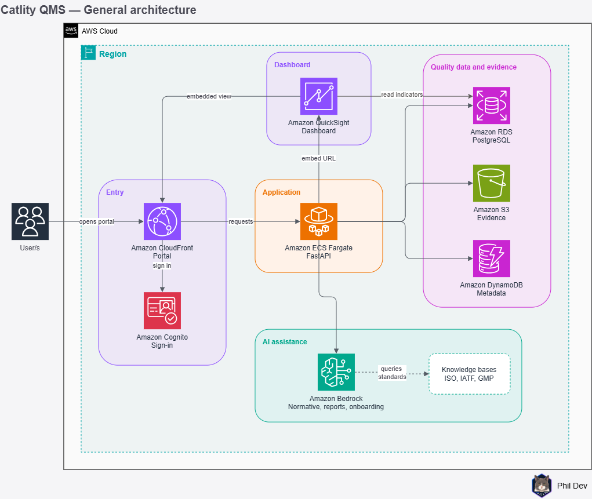
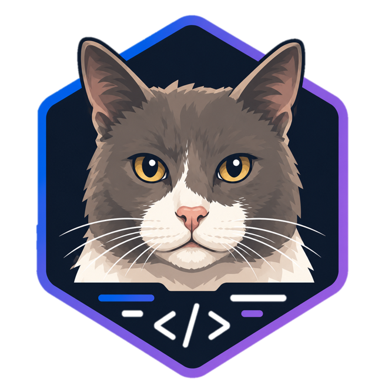

# Catlity QMS

Multi-tenant SaaS platform for quality management and auditing, powered by specialized AI agents that understand industry-specific regulatory standards.

The MVP targets the quality industry (ISO 9001) with built-in extensibility for additional industries (aeronautica, food, etc.).


## Architecture



The platform is composed of:

- **Frontend**: React SPA with Ant Design, authentication via AWS Amplify/Cognito
- **Backend**: REST API built with FastAPI, targeted for ECS/Fargate
- **Database**: Amazon RDS PostgreSQL with multi-tenancy via `tenant_id`
- **Storage**: S3 for documentary evidence (Intelligent-Tiering), DynamoDB for evidence metadata
- **AI Agents**: 3 specialized agents on Amazon Bedrock with Knowledge Bases
  - Normative Agent (ISO/IATF/GMP regulatory queries)
  - Report Agent (audit report draft generation)
  - Onboarding Agent (new tenant configuration)
- **Dashboard**: Amazon QuickSight embedded with row-level security
- **IaC**: Terraform with mandatory tagging (`Project: catlity-qms`)

## Tech Stack

| Layer | Technology |
|-------|------------|
| Frontend | React + TypeScript + AWS Amplify + Ant Design |
| Backend API | FastAPI (Python); ECS/Fargate is the target runtime |
| Database | Amazon RDS PostgreSQL |
| Documents/Evidence | Amazon S3 |
| Metadata | Amazon DynamoDB |
| Authentication | Amazon Cognito |
| AI Agents | Amazon Bedrock + Knowledge Bases |
| Dashboard | Amazon QuickSight |
| IaC | Terraform |
| CI/CD | GitHub Actions (no workflow committed yet) |
| Cost Monitoring | AWS Cost Explorer. AWS Budgets is defined and not applied |

## Repository Structure

```
catlity-qms/
├── frontend/                 # React + TypeScript + Ant Design
├── backend/                  # FastAPI (Python)
│   ├── app/
│   │   ├── main.py          # FastAPI application entry point
│   │   ├── core/            # Config, database, security
│   │   ├── models/          # SQLAlchemy ORM models
│   │   ├── schemas/         # Pydantic request/response schemas
│   │   ├── api/v1/          # API route handlers
│   │   └── services/        # Business logic layer
│   ├── alembic/             # Database migrations
│   ├── tests/               # pytest test suite
│   ├── Dockerfile
│   ├── docker-compose.yml   # Local dev (PostgreSQL + API)
│   ├── requirements.txt
│   └── requirements-dev.txt
├── infra/                    # Terraform modules
├── docs/
│   ├── PLAN.md              # Full implementation plan
│   └── diagrams/            # Architecture diagrams (PNG)
├── knowledge-base/
│   ├── common/              # ISO 9001
│   ├── automotive/          # IATF 16949
│   └── pharmaceutical/      # GMP
├── .github/workflows/       # reserved for CI workflows
├── .gitignore
└── README.md
```

## Local Development Setup

### Prerequisites

- Python 3.12+
- Node.js 22.13+
- Docker and Docker Compose
- Terraform 1.6+
- AWS CLI configured with a valid profile

### Backend

```bash
cd backend
python -m venv .venv
source .venv/bin/activate  # Windows: .venv\Scripts\activate
pip install -r requirements-dev.txt

# Start local PostgreSQL
docker-compose up -d db

# Run migrations
alembic upgrade head

# Start API server (http://localhost:8000)
uvicorn app.main:app --reload

# Run tests
pytest tests/ -v

# Lint
ruff check .
```

Alternatively, run everything with Docker Compose:

```bash
cd backend
docker-compose up
```

The API will be available at `http://localhost:8000` with interactive docs at `/docs`.

#### Data Model

The backend uses a multi-tenant architecture with `tenant_id` on all tables:

- **Tenant** — Organization using the platform
- **User** — Team member linked to a tenant (roles: admin, lead_auditor, auditor, auditee, qa_manager)
- **Audit** — Audit session with state machine (planned → in_progress → completed → closed). Each transition stores `status_changed_at`. See `docs/diagrams/audit-state-machine.png`.
- **Finding** — Non-conformity or observation (types: major_nc, minor_nc, observation, improvement_opportunity). Lifecycle: open → in_progress → resolved → verified → closed, with a rejection from resolved back to in_progress. Each transition stores `status_changed_at`. See `docs/diagrams/finding-lifecycle.png`.
- **CorrectiveAction** — Action plan linked to a finding. One finding can hold several actions. The client sets description, due date, completion date, and optional effectiveness.
- **Checklist / ChecklistItem** — Audit template questions
- **Evidence** — File bytes live in S3 and metadata in DynamoDB. `finding_evidences` links one uploaded file to a finding, and the same file can be linked to several findings

See `docs/diagrams/data-model-erd.png` for the full ER diagram.

#### Authentication & Authorization

Authentication is handled by an Amazon Cognito User Pool. The frontend signs in
through Amplify and sends the resulting JWT as a `Bearer` token on every API
request. The backend validates each token against the pool's JWKS (signature,
issuer, and audience) and derives the caller's identity from Cognito claims.

- **Tenant isolation**: the `custom:tenant_id` claim is required on every token
  and scopes all data access.
- **Roles**: `admin`, `qa_manager`, `lead_auditor`, `auditor`, `auditee` — carried in the
  `custom:role` attribute and mirrored as Cognito groups.
- **Role enforcement**: routes declare `Depends(require_role([...]))`; access is
  granted when the user's role or group matches.

Relevant endpoints:

| Method | Path | Description |
|--------|------|-------------|
| `POST` | `/api/v1/auth/register` | Provision a user in Cognito and persist the local profile |
| `GET`  | `/api/v1/auth/me` | Return the authenticated principal (tenant, role, groups) |
| `POST` | `/api/v1/audits/` | Create an audit for the token tenant. Roles: `auditor`, `admin`, `lead_auditor`. Status is always `planned`. A `qa_manager` cannot create |
| `GET`  | `/api/v1/audits/` | List that tenant's audits. Query: `skip`, `limit`, optional `status`, `audit_type`, and `mine` |
| `GET`  | `/api/v1/audits/{audit_id}` | Return one audit when it belongs to the token tenant |
| `PATCH` | `/api/v1/audits/{audit_id}` | Update title, description, audit type, or planned date. A `qa_manager` can only view |
| `PATCH` | `/api/v1/audits/{audit_id}/auditor` | Assign `auditor_id`. Role: `lead_auditor`. The user must be an active `auditor` of the same tenant |
| `PATCH` | `/api/v1/audits/{audit_id}/status` | Move one step forward: `planned` → `in_progress` → `completed` → `closed`. The assigned auditor, or a tenant `admin`, may move it. Invalid transitions return 422 and each change stores `status_changed_at` |
| `GET`  | `/api/v1/auditors/` | List active auditors of the token tenant. Roles: `lead_auditor`, `admin` |
| `POST` | `/api/v1/audits/{audit_id}/findings` | Create a finding on an audit of the token tenant. Roles: `auditor`, `admin`, `lead_auditor`. Status is always `open` and `assignee_id` stays empty. Types: `major_nc`, `minor_nc`, `observation`, `improvement_opportunity` |
| `GET`  | `/api/v1/audits/{audit_id}/findings` | List findings of that audit. Query: `skip`, `limit` |
| `GET`  | `/api/v1/findings` | List the tenant's findings. Query: `skip`, `limit`, optional `finding_type`, `audit_id`, and `status` |
| `PATCH` | `/api/v1/findings/{finding_id}` | Update title, description, type, severity, or clause reference. Status, assignee, and the parent audit stay unchanged. A `qa_manager` or `auditee` cannot edit |
| `PATCH` | `/api/v1/findings/{finding_id}/status` | Move one allowed step. The assigned auditee, or an admin, moves `open` → `in_progress` → `resolved`. An `auditor`, `lead_auditor`, or admin verifies (`resolved` → `verified`), rejects (`resolved` → `in_progress`), or closes (`verified` → `closed`). Invalid transitions return 422 and each change stores `status_changed_at` |
| `POST` | `/api/v1/findings/{finding_id}/corrective-actions` | Create an action on a finding of the token tenant. The assigned auditee, or an admin, may create it. Status stays `pending` and `responsible_id` stays empty |
| `GET`  | `/api/v1/findings/{finding_id}/corrective-actions` | List that finding's actions. Query: `skip`, `limit`. Any authenticated role of the tenant can read |
| `GET`  | `/api/v1/corrective-actions/{action_id}` | Return one action when it belongs to the token tenant |
| `PATCH` | `/api/v1/corrective-actions/{action_id}` | Update description, due date, completion date, or effectiveness. Status, action type, responsible, and the parent finding stay unchanged |
| `DELETE` | `/api/v1/corrective-actions/{action_id}` | Delete one action. The assigned auditee, or an admin, may delete it |
| `POST` | `/api/v1/evidence/upload-url` | Sign a PUT to the evidence bucket. Any authenticated role of the tenant. PDF, PNG, JPG, and DOCX only, up to 25 MB. The URL expires in 15 minutes |
| `POST` | `/api/v1/evidence/{evidence_id}/confirm` | After the PUT, check the object and mark its DynamoDB metadata `uploaded` |
| `GET`  | `/api/v1/evidence/{evidence_id}/download-url` | Sign a GET for an uploaded object of the token tenant. The URL expires in 15 minutes. A pending upload returns 422. Another tenant receives 404 |
| `POST` | `/api/v1/findings/{finding_id}/evidence` | Link an uploaded evidence file to a finding of the token tenant. Any authenticated role. The same file can be linked to several findings. Linking the same pair again returns 409. A pending upload returns 422 |
| `GET`  | `/api/v1/findings/{finding_id}/evidence` | List evidence linked to that finding. File name, type, size, and S3 key come from DynamoDB. Any authenticated role of the tenant can read |
| `POST` | `/api/v1/ai/normative/query` | Ask the normative advisor. Body: `{ "question": "..." }`. Any authenticated role. The answer cites the study-note file name. An automotive tenant reads common and automotive notes; a pharmaceutical tenant reads common and pharmaceutical notes. Ten queries per minute per user |

Audit rows stay in PostgreSQL. In local development that database is the Docker Compose Postgres service, not Amazon RDS. These routes do not call AWS on each request and do not add IAM permissions. They read `custom:tenant_id` and `custom:role` from the Cognito JWT the API already validates. There is no delete route and no `lead_auditor_id` column. The executing auditor is `auditor_id`, which already existed. The `lead_auditor` role is a new group in the existing Cognito module. Applying that group updates User Pool `us-east-1_oa6gNvB4B` only, with `terraform apply -target=module.cognito`. A Cognito group has no monthly charge. VPC, NAT Gateway, and RDS remain unapplied, so this change stays at **$0/month**. Check the API with `pytest tests/test_audits.py tests/test_audit_status.py tests/test_audit_assignment.py -v` from `backend/`. A passing run does not require `terraform apply`.

Finding rows use the `findings` table that already exists in that same schema. Create, list, and descriptive update add no AWS resource and no IAM permission, and they do not change User Pool `us-east-1_oa6gNvB4B`. These routes do not assign `assignee_id`. Check them with `pytest tests/test_findings.py -v` from `backend/`.

Status changes are a separate route. Migration `003` adds nullable `status_changed_at` on `findings`, the same kind of column audits already store. That migration is not applied to Amazon RDS. The route still reads `custom:tenant_id` and `custom:role` from the Cognito JWT the API already validates. VPC, NAT Gateway, and RDS stay unapplied, so findings stay at **$0/month**. The dev User Pool remains `us-east-1_oa6gNvB4B`. Check the lifecycle with `pytest tests/test_finding_status.py -v` from `backend/`. That run uses in-memory SQLite and does not need Docker or `terraform apply`. See `docs/diagrams/finding-lifecycle.png`.

Corrective actions use the `corrective_actions` table that already points at `findings`. Migration `004` adds nullable `effectiveness` (`String(255)`) and is not applied to Amazon RDS. The routes add no AWS resource and no IAM permission. A finding can hold several actions. The assigned auditee, or an admin, creates, edits, and deletes them. Any authenticated role of the tenant can read them. VPC, NAT Gateway, and RDS stay unapplied, so this stays at **$0/month**. The dev User Pool remains `us-east-1_oa6gNvB4B`. Check it with `pytest tests/test_corrective_actions.py -v` from `backend/`. That run uses in-memory SQLite and does not need Docker or `terraform apply`.

Evidence files go straight to the existing bucket `catlity-qms-dev-evidence`. `POST /api/v1/evidence/upload-url` signs the PUT locally for 15 minutes and includes `Content-Type`, `Content-Length`, and `x-amz-storage-class: INTELLIGENT_TIERING`. A pending row is written to the DynamoDB table `catlity-qms-dev-evidence`. `POST /api/v1/evidence/{evidence_id}/confirm` reads the object and sets that row to `uploaded`. The PostgreSQL `evidences` table is not used here. Signing the URL adds no AWS resource. The process credentials need `s3:PutObject` and `s3:GetObject` on the bucket, plus `dynamodb:PutItem`, `GetItem`, and `UpdateItem` on the table. A real PUT and one metadata write stay under $0.01. Tests mock those calls. Check them with `pytest tests/test_evidence.py -v` from `backend/`. That run does not need Docker or `terraform apply`.

Linking an uploaded file writes one row in PostgreSQL `finding_evidences`: `tenant_id`, `finding_id`, `evidence_id`, `linked_by`, and `created_at`. `evidence_id` is the DynamoDB sort key. Migration `005` creates that table and is not applied to Amazon RDS. `POST` and `GET /api/v1/findings/{finding_id}/evidence` call `dynamodb:GetItem` on the existing table `catlity-qms-dev-evidence`. They do not call S3 and add no AWS resource. The task role `catlity-qms-dev-backend-task` still does not exist; local runs use the process credentials. On-demand reads are about $0.25 per million, so a link or a short list stays at **$0/month**. The dev User Pool remains `us-east-1_oa6gNvB4B`. The same file can be linked to several findings. A repeated pair returns 409. A pending row returns 422. Another tenant receives 404. See `docs/diagrams/data-model-erd.png`. Check it with `pytest tests/test_evidence_links.py -v` from `backend/`. That run uses in-memory SQLite and a fake DynamoDB store and does not need Docker or `terraform apply`.

`GET /api/v1/evidence/{evidence_id}/download-url` signs a 15-minute GET for a row already marked `uploaded`. It uses the same bucket `catlity-qms-dev-evidence` and the same `s3:GetObject` permission the confirm step already needs for `HeadObject`. It adds no AWS resource. Signing stays at **$0/month**. A real GET is about $0.0004 per 1,000 requests. A pending row returns 422. Another tenant receives 404. The browser upload flow is in `docs/diagrams/evidence-upload-flow.png`. Check the route with `pytest tests/test_evidence.py -v` from `backend/`. That run mocks S3 and DynamoDB and does not need Docker or `terraform apply`.

Required environment variables (see `backend/.env.example`):

```
AWS_REGION=us-east-1
EVIDENCE_BUCKET_NAME=catlity-qms-dev-evidence
EVIDENCE_TABLE_NAME=catlity-qms-dev-evidence
COGNITO_USER_POOL_ID=<pool id from terraform output>
COGNITO_APP_CLIENT_ID=<app client id from terraform output>
```

The Cognito User Pool, groups, and app client are provisioned by the
`infra/modules/cognito` Terraform module. See `docs/diagrams/auth-flow.png`
for the end-to-end sign-in and token validation flow.

### Frontend

```bash
cd frontend
npm install
cp .env.example .env.local   # then fill in the Cognito values

# Start dev server (http://localhost:5173)
npm run dev

# Unit tests (Vitest + React Testing Library)
npm test

# Lint and formatting
npm run lint
npm run format:check   # npm run format to fix

# Production build (type-check + bundle into dist/)
npm run build
```

The frontend uses React 19 + TypeScript + Vite with Ant Design as the UI library.
Dependency versions are pinned exactly (`frontend/.npmrc` sets `save-exact=true`).

Environment variables (`frontend/.env.local`, not committed):

| Variable | Source |
|----------|--------|
| `VITE_COGNITO_USER_POOL_ID` | `terraform output -raw cognito_user_pool_id` |
| `VITE_COGNITO_APP_CLIENT_ID` | `terraform output -raw cognito_app_client_id` |
| `VITE_API_BASE_URL` | Backend URL, `http://localhost:8000` by default |

Sign-in uses AWS Amplify against the Cognito User Pool. Tokens are kept in
memory rather than `localStorage` to limit XSS exposure, so a full page reload
ends the session. Registration goes through `POST /api/v1/auth/register` so the
tenant and role are assigned server-side. Without the Cognito variables the app
still runs and shows a configuration warning on the sign-in screen.

The Audits screen calls the local API (`/api/v1/audits` and `/api/v1/auditors`)
with the Cognito ID token. It adds no AWS resource and no IAM permission.
Estimated cost stays **$0/month**. RDS and NAT remain unapplied. The dev User
Pool is `us-east-1_oa6gNvB4B`.

The finding detail drawer uploads evidence with drag and drop. The bytes go to
the existing bucket with the presigned PUT, and the drawer shows a progress
bar, an image preview or the document name, and a download button per file.
Download opens the 15-minute GET from `GET /api/v1/evidence/{evidence_id}/download-url`.
The screen adds no AWS resource and no IAM permission beyond the `s3:GetObject`
the API already uses to sign that GET. Estimated cost stays **$0/month**. A PUT
from the browser needs the CORS rule on `catlity-qms-dev-evidence` (origin
`http://localhost:5173`). That rule is in `module.evidence` and is not applied
yet. See `docs/diagrams/evidence-upload-flow.png`.

The AI Agent screen at `/ai-agent` asks the normative advisor through the existing
`POST /api/v1/ai/normative/query`. The body is `{ "question": "..." }` and the
request carries the Cognito ID token. The thread stays on the page until reload
or navigation. Each reference link opens the study-note file name, which the API
returns as both `document` and `section`. Those notes stay in the private bucket
`catlity-qms-dev-knowledge-base`. This screen adds no AWS resource and no IAM
permission. Estimated cost stays **$0/month** while no question reaches the model.

### Infrastructure

```bash
cd infra
terraform init
terraform plan
terraform apply
```

## Cost Monitoring

All AWS resources are tagged with `Project: catlity-qms` for filtering in Cost Explorer. The dev budget is $50/month, with alerts at 50%, 80%, and 100%. That budget module is defined in Terraform and has not been applied.

The Cognito deploy is estimated at **$0/month** in `us-east-1`. It applies only `module.cognito`. New user pools use the Essentials tier, which includes 10,000 monthly active users at no charge. The Terraform state bucket (`catlity-qms-terraform-state`) is versioned and encrypted with SSE-S3; at a few kilobytes it stays under $0.01/month. State locking uses an S3 lock file (`use_lockfile`) instead of a DynamoDB table.

Evidence storage is `module.evidence`. It was applied with `terraform apply -target=module.evidence`. The dev names are the S3 bucket `catlity-qms-dev-evidence` and the DynamoDB table `catlity-qms-dev-evidence`. The bucket uses SSE-S3, versioning, and a lifecycle rule that moves objects to Intelligent-Tiering on day 0. Noncurrent versions expire after 90 days. Objects under 128 KB stay in the Frequent Access tier and do not pay the monitoring fee. The table is on-demand, with partition key `tenant_id` and sort key `evidence_id`, encrypted with the AWS owned key. Point-in-time recovery is off. Public access is blocked, and the bucket policy denies HTTP plus any principal other than the reserved role `catlity-qms-dev-backend-task`, the principal running Terraform, and the account root. That role is not created yet. An empty bucket and an idle on-demand table are **$0/month**. In `us-east-1`, later usage is about $0.023 per GB-month in the Frequent Access tier, $0.0125 in Infrequent Access, $0.004 in Archive Instant Access, and $0.0025 per 1,000 monitored objects. DynamoDB on-demand is about $1.25 per million writes, $0.25 per million reads, and $0.25 per GB-month. One gigabyte of evidence and a few thousand metadata items stay under $0.10/month, inside the $50 dev budget. The bucket and the table now exist in `us-east-1`. A full `terraform apply` would also create the NAT Gateway and RDS. The identity that runs Terraform needs `s3:CreateBucket`, the evidence bucket `PutBucket*` calls, `dynamodb:CreateTable`, `DescribeTable`, and `TagResource`. The diagram source is `docs/diagrams/evidence-storage-architecture.drawio`.

`module.evidence` also defines CORS on that same bucket so a browser on `http://localhost:5173` can send the presigned PUT. Allowed methods are PUT, GET, and HEAD. Allowed headers are `Content-Type`, `Content-Length`, and `x-amz-storage-class`. CORS has no monthly charge. It is not applied yet. Check it with `terraform plan -target=module.evidence` from `infra/`. Apply that target only when the browser PUT should hit the real bucket. NAT, RDS, the budget, and User Pool `us-east-1_oa6gNvB4B` stay out of that plan. The upload flow is `docs/diagrams/evidence-upload-flow.drawio`.

Normative reference files are `module.knowledge_base`. It was applied with `terraform apply -target=module.knowledge_base`. The dev bucket name is `catlity-qms-dev-knowledge-base`, separate from `catlity-qms-dev-evidence`. Objects use the Standard storage class, SSE-S3, and versioning. Public access is blocked. The bucket policy denies HTTP and any principal other than the role `catlity-qms-dev-bedrock-kb`, the principal running Terraform, and the account root. `module.bedrock` creates that role and grants it `s3:GetObject` and `s3:ListBucket` on this bucket.

Nine plain-text study notes are in the bucket, uploaded from `knowledge-base/` in this repository: three ISO 9001 notes under `knowledge-base/common/`, three IATF 16949 notes under `knowledge-base/automotive/`, and three GMP notes under `knowledge-base/pharmaceutical/`. Each note is an original summary for the normative agent. It is not the official text of a standard. Editing a file and applying this module again replaces the object; versioning keeps the previous copy. The corpus is shared by the platform. A tenant does not upload these files. The tenant `industry` only selects which prefix a later query may read.

The nine objects stay at **$0/month** in `us-east-1`. S3 Standard is about $0.023 per GB-month, and these files are well under 1 MB. The nine PUT requests on apply were under $0.01. Intelligent-Tiering is not used because the objects are tiny and a later sync re-reads them. On Azure the same split is a dedicated Blob container; on Google Cloud, a separate bucket. The bucket now exists in `us-east-1`. A full `terraform apply` would also create the NAT Gateway and RDS. NAT, RDS, the budget, and User Pool `us-east-1_oa6gNvB4B` stayed out of this apply. The identity that runs Terraform needs `s3:CreateBucket`, the bucket `PutBucket*` calls, `s3:PutObject`, `s3:GetObject`, and `s3:ListBucket` on this bucket. Check the objects with `aws s3 ls s3://catlity-qms-dev-knowledge-base/knowledge-base/ --recursive`.

`module.bedrock` was applied with `terraform apply -target=module.bedrock`. It creates three Bedrock knowledge bases (`catlity-qms-dev-common`, `catlity-qms-dev-automotive`, `catlity-qms-dev-pharmaceutical`), each with an S3 data source on the matching prefix of `catlity-qms-dev-knowledge-base`. Vectors go to `catlity-qms-dev-vectors`, with one index per corpus. OpenSearch Serverless is not used: a Classic collection keeps at least two OCUs running, about $350/month in `us-east-1`. S3 Vectors bills storage at about $0.06 per GB-month and has no idle compute charge. The embedding model is Titan Text Embeddings V2. The ingestion jobs for the nine notes completed. That sync was under $0.01, and the stored vectors stay under $0.01/month. Bedrock Agents classic is in maintenance mode on this account, so `CreateAgent` is not used.

Normative Advisor is the AgentCore harness `Normative_Advisor`. Harness names allow letters, digits, and underscores. The system prompt tells it to answer only from the study notes and to cite the file name. Memory is turned off, so an unused harness does not keep a memory store. The harness has no monthly fee. While a question runs, the runtime is about $0.0895 per vCPU-hour and $0.00945 per GB-hour, and the answer model is the US Nova Micro inference profile, which is pay-per-use. With no questions the harness stays at **$0/month**. `common_tags` are on the harness, the gateway, the Lambda, the roles, and the vector indexes. The id is `terraform output bedrock_harness_id`.

The built-in gateway connector accepts only a managed knowledge base. These three are vector knowledge bases, so the harness reaches them through the AgentCore gateway `catlity-qms-dev-normative` (IAM auth, MCP) and the Lambda `catlity-qms-dev-normative-retrieve` (Python 3.12, 128 MB, no VPC). The function calls `bedrock:Retrieve` on the corpus named in the tool input: `common`, `automotive`, or `pharmaceutical`. The gateway is about $0.005 per 1,000 invocations and has no idle charge. Lambda for this volume stays inside the free tier. The execution role is `catlity-qms-dev-bedrock-agent`, trusted by `bedrock-agentcore.amazonaws.com`. The gateway role is `catlity-qms-dev-bedrock-gateway` and the Lambda role is `catlity-qms-dev-bedrock-retrieve`. On Azure the closest split is AI Search plus a consumption function. On Google Cloud it is Vector Search plus a Cloud Run service that scales to zero; Vector Search still bills a node while the index is deployed.

`POST /api/v1/ai/normative/query` is the way an authenticated user asks those notes a question. The body is `{ "question": "..." }`. The API loads `tenants.industry` for the token's `custom:tenant_id` and calls `bedrock:Retrieve` only on the allowed knowledge bases: common `OTQJ8TMBNI` plus automotive `QWONN58E2H`, or common plus pharmaceutical `DX3IVAFQ6K`. It then calls `bedrock-agentcore:InvokeHarness` on `Normative_Advisor-CLJ73dVHYz` with an empty tool list for that request. The model writes the answer from the passages the API already fetched. The response has `answer` and `references`. Each reference puts the Retrieve file name in both `document` and `section`, because the notes are plain text and have no page number. When Retrieve returns nothing, the API says the notes do not cover the question and does not call the harness. The same user, identified by the token `sub`, can send 10 queries per minute. The counter lives in the API process. ElastiCache is not used. This route adds no AWS resource. The process credentials need `bedrock:Retrieve` on the three knowledge base ARNs and `bedrock-agentcore:InvokeAgentRuntime` on the harness ARN. The boto3 call is `invoke_harness`; AgentCore authorizes it as `InvokeAgentRuntime`. For local runs that access is the inline policy `catlity-qms-normative-query` on the IAM user `devops-ariel`. Check it with `aws iam get-user-policy --user-name devops-ariel --policy-name catlity-qms-normative-query`. `bedrock:InvokeModel` stays on the existing role `catlity-qms-dev-bedrock-agent`. With no questions the cost stays **$0/month**. A question bills Titan Text Embeddings V2 at $0.02 per million tokens, Nova Micro at $0.035 per million input tokens and $0.140 per million output tokens, and the harness runtime only while it runs, about $0.0895 per vCPU-hour and $0.00945 per GB-hour. One short question stays under $0.01. The gateway is not called on this path, so its $0.005 per 1,000 invocations does not apply here. Check the route with `pytest tests/test_normative_query.py -v` from `backend/`. That run mocks Bedrock and does not need Docker or `terraform apply`. See `docs/diagrams/agent-normative-architecture.png`.

The AWS provider is pinned to `6.71.0`, with the archive provider at `2.7.1` for the Lambda package. A full `terraform apply` would still create the NAT Gateway and RDS. NAT, RDS, the budget, and User Pool `us-east-1_oa6gNvB4B` stayed out of this apply. The identity that runs Terraform needs `bedrock-agentcore:CreateHarness`, `CreateAgentRuntime`, `CreateAgentRuntimeEndpoint`, `GetAgentRuntime`, `CreateGateway`, `CreateGatewayTarget`, `ListGatewayTargets`, `CreateWorkloadIdentity`, and `lambda:CreateFunction` on these names, plus `iam:PassRole` for the three Bedrock roles. Check the harness with `terraform output bedrock_harness_id` from `infra/`.

VPC, NAT Gateway, and RDS are in the Terraform configuration and were not applied with this change. A NAT Gateway is about $33/month and a `db.t3.micro` instance about $13/month before storage. The apply was limited to `terraform apply -target=module.cognito` to avoid that fixed cost.

## License

Proprietary — Phil Dev <sub></sub>
