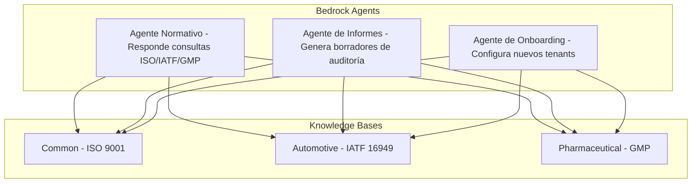

# Implementation Plan - Catlity QMS

## Problem Statement

Construir una plataforma SaaS multi-tenant que centralice la gestión de calidad y auditorías para empresas de distintas industrias, asistida por múltiples agentes de IA especializados (consultas normativas, generación de informes, onboarding) que conocen las normativas específicas de cada industria. El MVP debe ser funcional para un tenant (industria automotriz) con posibilidad de agregar más.

## Requirements

1. Multi-tenancy con tenant_id compartido en PostgreSQL
2. Self-service onboarding guiado por agente IA especializado
3. Gestión completa de auditorías: crear, asignar, ejecutar con checklist
4. Registro y seguimiento de hallazgos/no conformidades
5. Carga de evidencia documental vinculada a hallazgos
6. Agente IA de consultas normativas (RAG sobre Knowledge Base en Bedrock)
7. Agente IA de generación de informes de auditoría
8. Agente IA de onboarding (configura nuevo tenant según industria)
9. Notificaciones automáticas a auditados según hallazgos
10. Dashboard gerencial con KPIs de cumplimiento (QuickSight)
11. Portal web (React + TypeScript) con panel único por organización
12. Todos los recursos AWS etiquetados con `Project: catlity-qms` para monitoreo de costos
13. Dashboard de costos con AWS Cost Explorer + AWS Budgets con alertas
14. Diagramas `.drawio` por módulo (arquitectura, modelo de datos, flujos de usuario)
15. `.kiro/` en `.gitignore`

## Stack Tecnológico

| Capa | Tecnología |
|------|------------|
| Frontend | React + TypeScript + AWS Amplify + Ant Design |
| Backend API | FastAPI en ECS/Fargate (Python) |
| Base de datos relacional | Amazon RDS PostgreSQL |
| Documentos/evidencia | Amazon S3 |
| Metadatos e indexación | Amazon DynamoDB |
| Autenticación | Amazon Cognito |
| Agentes IA | Amazon Bedrock (3 agentes especializados + Knowledge Bases) |
| Knowledge Base storage | S3 + Bedrock vector store |
| Dashboard gerencial | Amazon QuickSight |
| IaC | Terraform |
| CI/CD | GitHub Actions |
| Diagramas | draw.io (.drawio) + exportados a PNG |
| Monitoreo costos | AWS Cost Explorer + AWS Budgets |

## Arquitectura Multiagente



## Estrategia de Tagging AWS

```hcl
locals {
  common_tags = {
    Project     = "catlity-qms"
    Environment = var.environment  # dev, staging, prod
    ManagedBy   = "terraform"
    Owner       = "phil-dev"
  }
}
```

## Estructura de Diagramas

```
docs/
├── diagrams/
│   ├── *.drawio        ← fuente editable
│   └── exports/
│       └── *.png       ← exportados para README y docs
```

## Steering Files (.kiro/)

```
.kiro/
├── steering/
│   ├── project-context.md      → Stack, decisiones de arquitectura, convenciones
│   ├── diagrams.md             → Todo módulo nuevo requiere diagrama .drawio
│   ├── aws-tagging.md          → Todo recurso Terraform incluye common_tags
│   ├── multi-agent.md          → Arquitectura multiagente y responsabilidades
│   └── cost-awareness.md       → Considerar costo en cada decisión de infra
└── specs/
    ├── authentication.md
    ├── audits.md
    ├── findings.md
    ├── ai-agents.md
    └── onboarding.md
```

## Task Breakdown

### Task 1: Inicialización del proyecto, estructura del repositorio y diagramas base

**Objetivo:** Crear la estructura monorepo, configurar Kiro (steering files), generar el diagrama de arquitectura general en .drawio, y establecer las bases del proyecto.

**Implementación:**

Crear estructura de directorios:

```
catlity-qms/
├── frontend/
├── backend/
├── infra/
├── docs/
│   └── diagrams/
│       └── exports/
├── knowledge-base/
│   ├── common/
│   ├── automotive/
│   └── pharmaceutical/
├── .github/workflows/
├── .kiro/               (steering + specs)
├── .gitignore           (incluye .kiro/)
└── README.md
```

- Inicializar Git con `.gitignore` que incluya `.kiro/`, `.env`, `node_modules/`, `.venv/`, `.terraform/`
- Crear `README.md` con descripción del proyecto, arquitectura (referencia al diagrama), stack y setup local
- Crear steering files en `.kiro/steering/`
- Crear diagramas base: `architecture-general.drawio` y `multi-agent-flow.drawio`
- Conectar remote: `https://github.com/arielsubia/catlity-qms.git`
- Commit + push a main

**Tests:** Validar estructura creada. `git status` limpio después del commit inicial.

**Demo:** Repo en GitHub con estructura clara, README documentado, steering files configurados, y diagramas base.

---

### Task 2: Infraestructura base con Terraform — Networking, RDS y tagging

**Objetivo:** Desplegar VPC, subnets, security groups y RDS PostgreSQL. Establecer patrón de tagging y configurar Cost Explorer + Budgets.

**Implementación:**

Terraform modules:

```
infra/
├── main.tf
├── variables.tf
├── outputs.tf
├── providers.tf
├── modules/
│   ├── networking/    (VPC, subnets, SG)
│   ├── database/      (RDS PostgreSQL)
│   └── cost/          (Budgets, alarms)
└── environments/
    └── dev/
        └── terraform.tfvars
```

- VPC con 2 subnets públicas + 2 privadas
- RDS PostgreSQL `db.t3.micro` en subnet privada
- `locals` con `common_tags` aplicados a todos los recursos
- Módulo cost: AWS Budget con alerta al 50%, 80% y 100% (presupuesto mensual $50 USD dev)
- SNS topic para alertas de presupuesto → email
- Diagrama: `docs/diagrams/infrastructure-networking.drawio`

**Tests:** `terraform validate` pasa. `terraform plan` sin errores. Tags visibles en consola AWS. Budget creado.

**Demo:** Infraestructura desplegada, tags en Cost Explorer, alerta de budget configurada.

---

### Task 3: Backend — FastAPI setup con modelo de datos y migraciones

**Objetivo:** Crear la API FastAPI con modelo de datos multi-tenant, migraciones con Alembic y endpoints de health check.

**Implementación:**

Proyecto FastAPI con estructura modular:

```
backend/
├── app/
│   ├── main.py
│   ├── core/         (config, security, database)
│   ├── models/       (SQLAlchemy models)
│   ├── schemas/      (Pydantic schemas)
│   ├── api/v1/       (routers)
│   └── services/     (business logic)
├── alembic/
├── tests/
├── requirements.txt
├── requirements-dev.txt
├── Dockerfile
└── docker-compose.yml
```

- Modelos: Tenant, User, Audit, Finding, CorrectiveAction, Checklist, Evidence
- Todas las tablas con `tenant_id` como discriminador
- Migraciones con Alembic
- Docker Compose para desarrollo local (PostgreSQL + FastAPI)
- Endpoints: `/health`, `/api/v1/tenants` (CRUD básico)
- Diagrama: `docs/diagrams/data-model-er.drawio`

**Tests:** pytest con fixtures. Tests de modelos, migraciones y endpoint health. Coverage mínimo 80%.

**Demo:** `docker-compose up` levanta todo. Health responde. Schema multi-tenant migrado. Diagrama ER.

---

### Task 4: Autenticación — Amazon Cognito + integración con FastAPI

**Objetivo:** Configurar Cognito User Pool con roles e integrar autenticación JWT en FastAPI.

**Implementación:**

- Terraform: Cognito User Pool con custom attributes (`tenant_id`, `role`)
- Grupos: `admin`, `auditor`, `auditee`, `qa_manager`
- App Client para frontend
- Middleware JWT en FastAPI para validar tokens de Cognito
- Dependencia `get_current_user` que extrae `tenant_id` y `role`
- Decorador `@require_role(["auditor", "admin"])`
- Endpoint `POST /api/v1/auth/register`
- Diagrama: `docs/diagrams/auth-flow.drawio`

**Tests:** Token válido/inválido. Autorización por rol. Aislamiento por `tenant_id`.

**Demo:** Registro, login, token JWT, acceso protegido por rol.

---

### Task 5: Frontend — Setup React + Amplify + autenticación + layout

**Objetivo:** App React con Ant Design, auth con Cognito via Amplify, layout base del panel.

**Implementación:**

- Vite + React + TypeScript
- AWS Amplify para auth
- Ant Design: Layout con Sider, Header, Content
- Sidebar: Dashboard, Auditorías, Hallazgos, Evidencia, Agente IA, Configuración
- Páginas: Login, Register, Dashboard (placeholder)
- React Router con rutas protegidas
- Diagrama: `docs/diagrams/frontend-navigation-flow.drawio`

**Tests:** React Testing Library: render, login flow, route protection.

**Demo:** Login funcional contra Cognito, layout profesional, navegación.

---

### Task 6: CRUD de Auditorías — Backend + Frontend integrado

**Objetivo:** Gestión completa de auditorías con flujo de estados, end-to-end.

**Implementación:**

- Backend: CRUD `/api/v1/audits`, máquina de estados (`planned → in_progress → completed → closed`)
- Asignación de auditores, filtros, paginación
- Frontend: Tabla con filtros, formulario de creación, vista detalle, cambio de estado
- Diagrama: `docs/diagrams/audit-state-machine.drawio`

**Tests:** CRUD completo. Transiciones válidas/inválidas. Componentes frontend.

**Demo:** Crear auditoría, asignar auditor, cambiar estado. Todo integrado.

---

### Task 7: Hallazgos y No Conformidades

**Objetivo:** Registro de hallazgos vinculados a auditorías con clasificación, severidad y responsable.

**Implementación:**

- Backend: CRUD `/api/v1/audits/{audit_id}/findings`
- Tipos: `major_nc`, `minor_nc`, `observation`, `improvement_opportunity`
- Estados: `open → in_progress → resolved → verified → closed`
- Frontend: Listado, formulario, timeline de estados, badges de severidad
- Diagrama: `docs/diagrams/finding-lifecycle.drawio`

**Tests:** CRUD, validaciones de negocio, UI components.

**Demo:** Registrar hallazgos de distintos tipos, asignar responsables, ver resumen visual.

---

### Task 8: Carga de evidencia (S3 + DynamoDB)

**Objetivo:** Upload de documentos y fotos como evidencia vinculada a hallazgos.

**Implementación:**

- Terraform: S3 bucket + DynamoDB table para metadatos
- Backend: Presigned URLs + registro de metadatos
- Frontend: Upload drag & drop, preview, galería
- Diagrama: `docs/diagrams/evidence-upload-flow.drawio`

**Tests:** Presigned URL generation. Registro en DynamoDB. Aislamiento por tenant.

**Demo:** Subir PDF + imagen como evidencia de un hallazgo. Ver listado.

---

### Task 9: Agente IA Normativo — Knowledge Base y consultas

**Objetivo:** Primer agente Bedrock que responde consultas normativas con RAG.

**Implementación:**

- S3 con documentos de referencia (`common/` + `automotive/` + `pharmaceutical/`)
- Terraform: Bedrock Knowledge Base + Agent "Normative Advisor"
- Backend: `POST /api/v1/ai/normative/query`
- Frontend: Panel de chat para interactuar con el agente
- Diagrama: `docs/diagrams/agent-normative-architecture.drawio`

**Tests:** Invocación con query conocida. Respuestas con referencias. Aislamiento por tenant.

**Demo:** Preguntar sobre IATF 16949 y recibir respuesta contextual con cita del documento.

---

### Task 10: Agente IA de Informes — Generación de borradores

**Objetivo:** Segundo agente que genera borradores de informes basados en hallazgos y normativa.

**Implementación:**

- Terraform: Bedrock Agent "Report Generator" con action groups
- Backend: `POST /api/v1/ai/reports/generate`
- Frontend: Botón "Generar informe", vista editable, exportar PDF
- Diagrama: `docs/diagrams/agent-report-flow.drawio`

**Tests:** Generación con datos de ejemplo. Todas las secciones presentes. Edición y guardado.

**Demo:** Auditoría con hallazgos → generar informe → editar → exportar PDF.

---

### Task 11: Notificaciones automáticas a auditados (SES)

**Objetivo:** Envío automático de emails por hallazgos asignados y acciones vencidas.

**Implementación:**

- Terraform: SES + SNS + DynamoDB (historial notificaciones)
- Backend: Servicio de notificaciones, templates de email
- Frontend: Campana con badge, dropdown, página de notificaciones
- Diagrama: `docs/diagrams/notification-flow.drawio`

**Tests:** Trigger al crear hallazgo. Envío SES (mock). Lectura/marcado.

**Demo:** Registrar hallazgo → auditado recibe email + notificación en panel.

---

### Task 12: Agente IA de Onboarding — Registro self-service de tenants

**Objetivo:** Tercer agente que guía al nuevo cliente para configurar su perfil de industria.

**Implementación:**

- Terraform: Bedrock Agent "Onboarding Assistant" con action groups (`create_tenant`, `assign_kb`, `generate_checklists`, `create_admin_user`)
- Backend: `POST /api/v1/onboarding/start`, `POST /api/v1/onboarding/message`
- Frontend: Wizard/chat de onboarding fuera del layout principal
- Diagrama: `docs/diagrams/agent-onboarding-flow.drawio`

**Tests:** End-to-end de onboarding. Validar creación de todos los recursos.

**Demo:** Registrar nuevo tenant guiado por agente → entrar al panel configurado.

---

### Task 13: Dashboard QuickSight — KPIs de cumplimiento

**Objetivo:** Dashboard gerencial embebido con métricas de calidad.

**Implementación:**

- Terraform: QuickSight dataset + row-level security
- Visualizaciones: cumplimiento %, hallazgos por tipo, tendencias, top cláusulas, auditorías por estado
- Backend: `GET /api/v1/quicksight/embed-url`
- Frontend: Página Dashboard con iframe embebido
- Diagrama: `docs/diagrams/dashboard-kpis.drawio`

**Tests:** Row-level security. Embed URL generation.

**Demo:** Dashboard con datos reales de auditorías, filtrable por periodo.

---

### Task 14: Deploy completo, CI/CD y monitoreo de costos

**Objetivo:** Desplegar toda la plataforma con pipeline automatizado.

**Implementación:**

- Terraform: ECS + ECR + API Gateway + S3 + CloudFront
- GitHub Actions: `ci.yml`, `deploy-backend.yml`, `deploy-frontend.yml`, `infra.yml`
- Secrets en GitHub + AWS Secrets Manager
- Health checks + auto-scaling básico
- Budget consolidado con alertas
- Diagrama: `docs/diagrams/cicd-pipeline.drawio`

**Tests:** Pipeline completo en feature branch. Smoke test post-deploy.

**Demo:** Push → pipeline verde → app actualizada. Cost Explorer filtrado por proyecto.

---

### Task 15: Segundo tenant (demo portfolio) + documentación final

**Objetivo:** Crear tenant farmacéutico, verificar aislamiento, documentar para portfolio.

**Implementación:**

- Onboarding "PharmaCorp" (farmacéutica)
- Documentos GMP en Knowledge Base
- Auditoría de ejemplo con hallazgos
- Verificar aislamiento completo (datos, KB, notificaciones, dashboard)
- README final con screenshots, setup local, architecture decisions
- API docs (Swagger)
- Diagrama: `docs/diagrams/complete-system-overview.drawio`

**Tests:** End-to-end con ambos tenants. Aislamiento total verificado.

**Demo:** Video mostrando onboarding → agente diferenciado por industria → dashboard aislado.

---

## Resumen de Diagramas .drawio

| Diagrama | Task |
|----------|------|
| `architecture-general.drawio` | 1 |
| `multi-agent-flow.drawio` | 1 |
| `infrastructure-networking.drawio` | 2 |
| `data-model-er.drawio` | 3 |
| `auth-flow.drawio` | 4 |
| `frontend-navigation-flow.drawio` | 5 |
| `audit-state-machine.drawio` | 6 |
| `finding-lifecycle.drawio` | 7 |
| `evidence-upload-flow.drawio` | 8 |
| `agent-normative-architecture.drawio` | 9 |
| `agent-report-flow.drawio` | 10 |
| `notification-flow.drawio` | 11 |
| `agent-onboarding-flow.drawio` | 12 |
| `dashboard-kpis.drawio` | 13 |
| `cicd-pipeline.drawio` | 14 |
| `complete-system-overview.drawio` | 15 |
